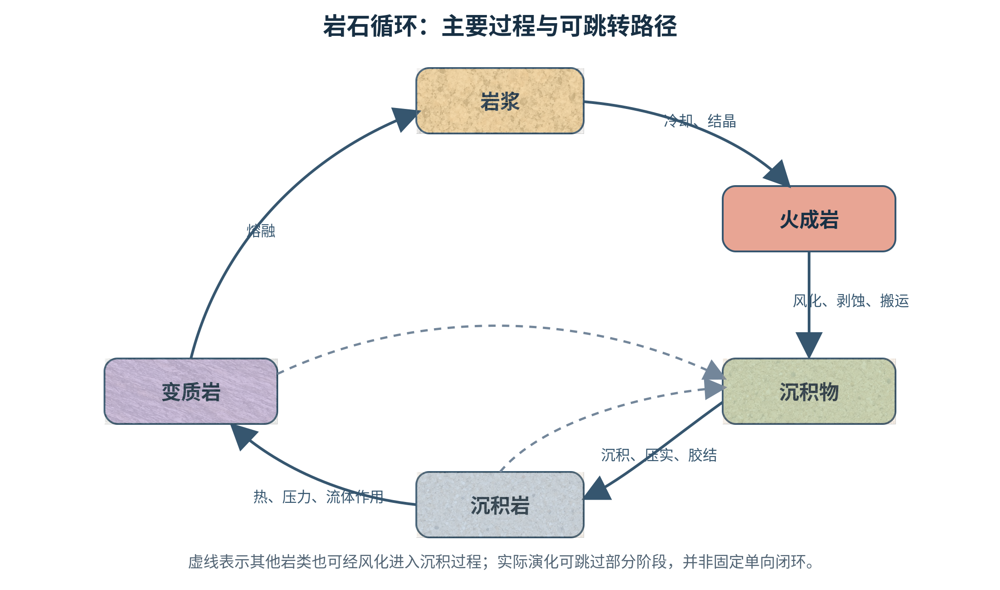
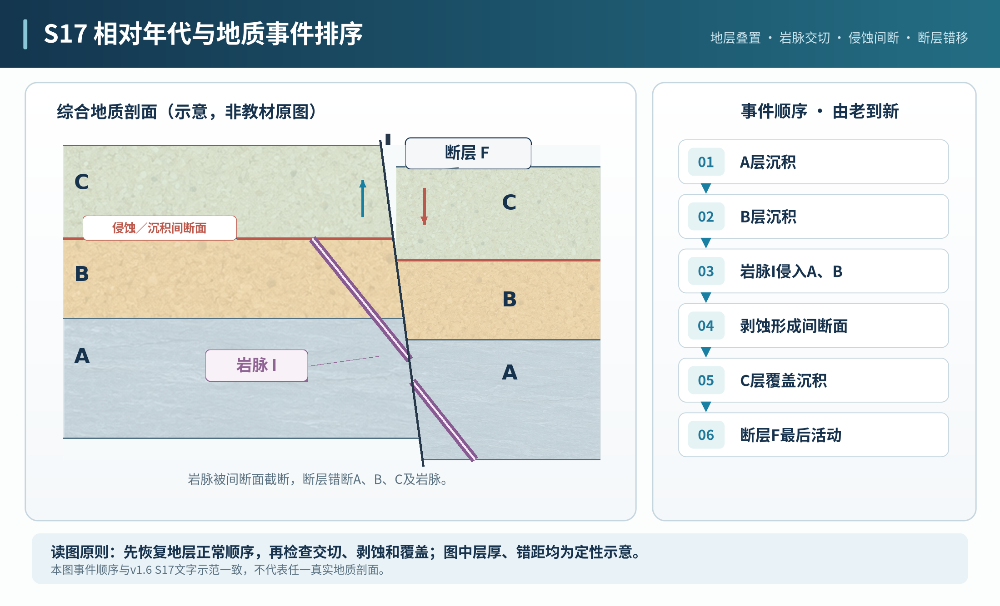
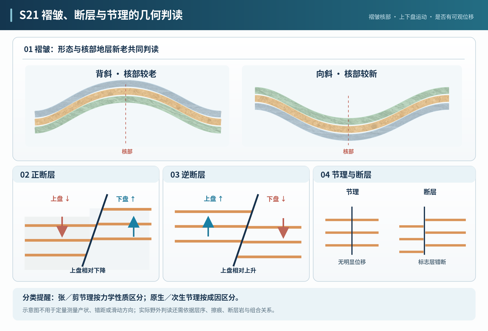
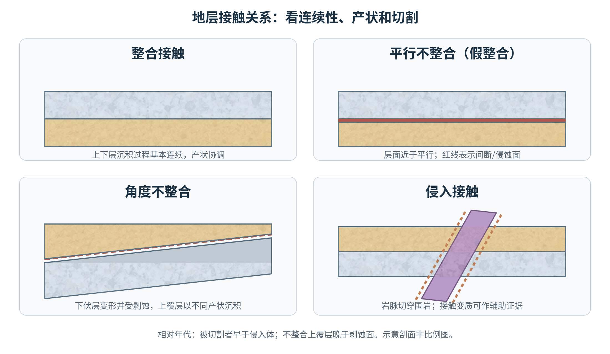
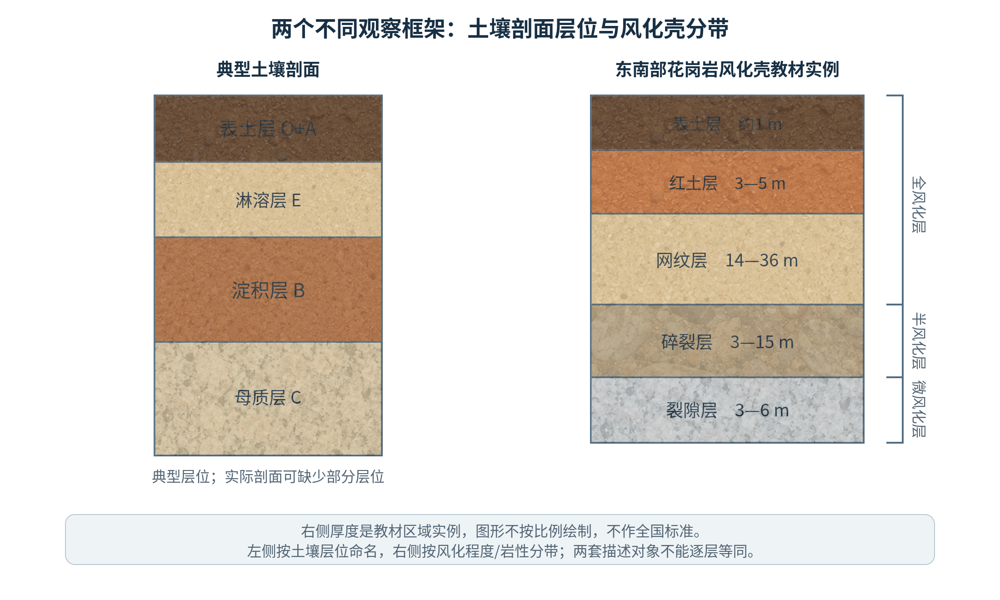
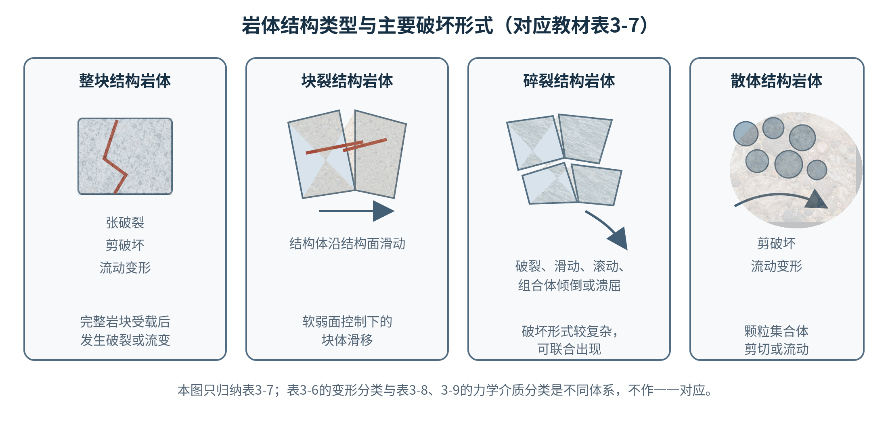
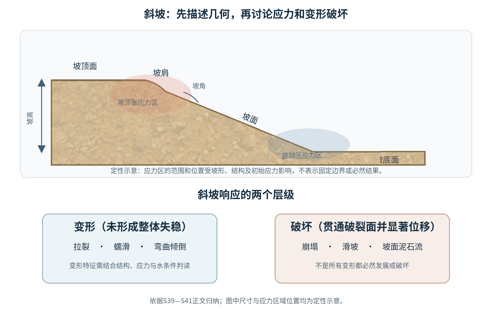
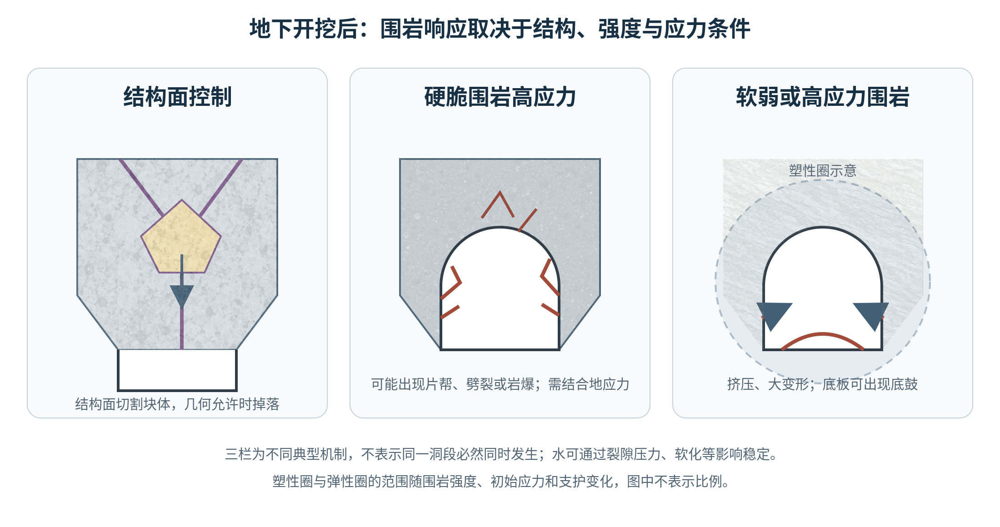
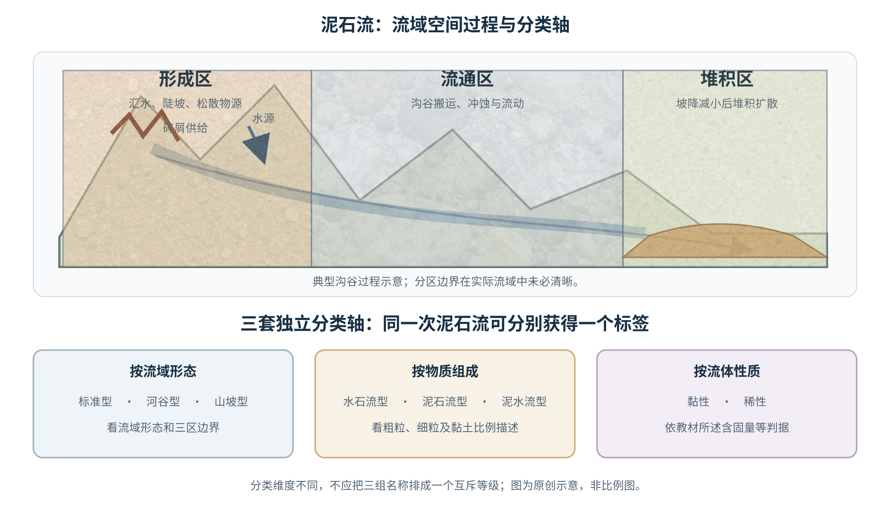
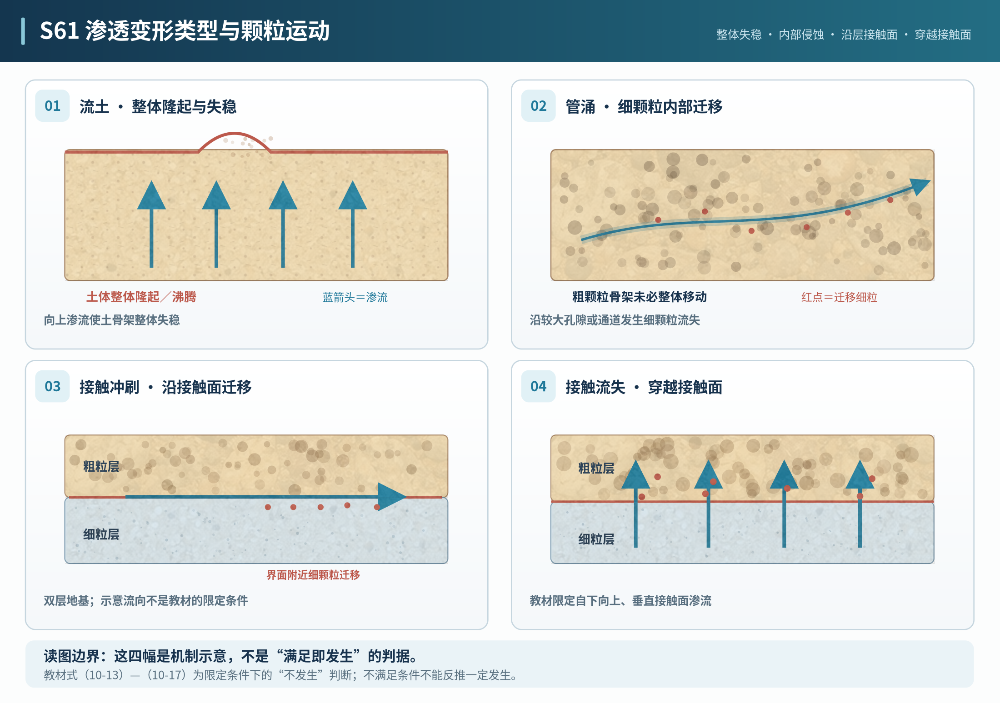

# 2027 福州大学 881《地质工程概论》考研知识纲要（v1.6 教学候选稿）

依据福州大学2027年881《地质工程概论》考试大纲、舒良树《普通地质学》第4版和唐辉明《工程地质学基础》第2版。全文保留62个单元的编号、顺序与考纲映射；内容覆盖应掌握的概念、分类、机理和必要公式，不替代教材全文、原图表与习题。文中页码优先标注教材纸质页，PDF页码用于扫描文件定位；单元教材定位不一定等于其中每个知识点的精确出处。

**版本说明：**以v1.5.1完整知识正文为基线，仅在需要处加入原创示意图、判别步骤和少量练习；没有替代教材知识或将教材疑点改写为确定结论。尚未完成专业教师审校，正式教学验收尚未通过。

**章节查找提示：**考试大纲工程地质部分4.1写“活断层的分类”，教材4.1为“概述”、相关活动分类在4.2；大纲10.4写“渗透变形类型及判别”，教材相应内容在10.3，第10.4节是“临界水力坡度的确定”。学习时按大纲知识范围掌握，按教材实际章节位置查找。

## 第一篇 普通地质学（舒良树）

### 01. 第1章 绪论 · 第四节 地质作用及其研究方法
*教材定位：普通地质学，本节约从纸质第3页起。*

- **地质作用定义**：自然力量使地球物质组成、结构、形态及所在位置发生变化的过程；地质作用包括内动力和外动力等不同作用系统。
- **内动力作用**：主要与地球内部热能和构造动力有关，表现为岩浆、变质、地壳运动及地震等；不能简单理解为所有作用都只来自“地下高温”。
- **外动力作用**：太阳辐射驱动的大气水循环与重力等共同促成风化、剥蚀、搬运和沉积；作用之间有过程先后但可以同时发生。
- **方法与证据**：野外量测地层产状、接触关系和构造现象，结合手标本、薄片、化学/同位素分析及地质图综合判断；单一观察不足以唯一确定成因。
- **历史推断**：“将今论古”是利用现代过程认识地质记录的研究思路；需考虑地质历史的环境差别，不能直接把现代速率外推全部地史。

- **地质作用的特点**：教材强调地质作用的时间尺度广、普遍发生且过程复杂；观察到的同一种地貌或构造现象可能与不同过程组合有关。  *【舒，第3页／PDF第13页】*

**教材原节**
- **研究方法层级**：教材列野外调查、仪器测量、理论分析三类；理论分析包括“将今论古”“以古论今”“活动论”。这些是研究思路，不是地质作用分类；使用“将今论古”时仍须检验古今边界条件是否可比。*【舒，第4页/PDF14】*

### 02. 第2章 矿物 · 第一节 矿物的概念
*教材定位：普通地质学，本节约从纸质第8页起。*

- **矿物定义**：按指定教材，矿物是地质作用形成的自然产物，正常情况下为结晶质的元素或无机化合物固体，是组成岩石和矿床的基本单元。人工合成物即使化学组成与矿物相同，也不因其材料相同而成为天然矿物；液态水、气体不满足固体条件；花岗岩是多种矿物集合体，不是单一矿物种。自然非晶质矿物与准矿物须结合教材定义辨析，不能仅凭外观判定。*【舒，第8—9页/PDF18—19】*
- **矿物与岩石**：矿物是组成岩石的基本组分，岩石可以由一种或多种矿物及其他组分构成；岩石名称不同于矿物种名。
- **晶体与非晶体**：晶体内部质点有规律排列，非晶质物质缺乏长程周期性结构；外形规则并不总能据此直接判定内部结构。
- **同质多象**：化学组成相同而晶体结构不同，如石墨与金刚石；物性差异来源于内部原子排列和键合差别。
- **类质同象**：结构类型保持类似时某些离子能够相互取代形成成分变化系列；需满足半径、电荷等晶体化学条件。

- **准矿物与晶质矿物**：教材专门区分晶体、非晶质体和准晶体。矿物种属判定不应仅凭外观规则与否；对缺乏周期性有序结构的自然物质，要结合教材关于准矿物的讨论理解。  *【舒，第8—9页／PDF第18—19页】*

### 03. 第2章 矿物 · 第二节 矿物手标本的鉴定特征
*教材定位：普通地质学，本节约从纸质第10页起。*

- **颜色与条痕**：颜色是观察表面反射光的直观表现，条痕是矿物粉末颜色，通常更稳定；染色和杂质可使颜色偏离常态。
- **光泽与透明度**：金属、半金属、玻璃、珍珠、丝绢、油脂等光泽是鉴定线索，应与矿物表面粗糙度及风化皮区分。
- **硬度**：摩氏硬度是相对刻划序列而非等间距物理量；指定教材举例为指甲约2—2.5、铜钥匙约3、窗玻璃为6。此数值是教材的窗玻璃示例，不推广为所有玻璃的固定硬度。*【舒，第12页/PDF22】*
- **解理与断口**：解理沿晶体内部较弱方向形成较规则的平面；断口不受解理面控制，可呈贝壳状、不平坦状等。
- **晶形与集合体**：完整晶形受生长空间制约，矿物集合体可呈粒状、纤维、板状、放射状等，不能仅凭一个外形排除其他矿物。
- **其他性质**：相对密度、磁性、酸反应、发光性和特殊触感可辅助诊断；实验反应须在合适安全条件下开展。
- **鉴定次序**：建议先观察晶形/颜色/光泽，再联合刻划硬度、条痕、解理、密度和特殊反应，以多项一致特征确认。
- **摩氏十级标准矿物**：常用顺序：滑石、石膏、方解石、萤石、磷灰石、正长石、石英、黄玉、刚玉、金刚石；摩氏标度是相对顺序。

- **矿物鉴定指标的层级**：教材将手标本的鉴定特征建立在形态及物理性质上，物理性质除硬度外还包括延展性、弹性、脆性、解理、断口、密度、磁性等；鉴定时应分项记录而非用颜色一项代替。解理完好程度分极完全、完全、中等、不完全四级；教材非金属矿物密度分轻（<2.5 g/cm³）、中（2.5—4.0 g/cm³）、重（>4.0 g/cm³）。*【舒，第10—13页/PDF20—23】*  *【舒，第10—13页／PDF第20—23页】*

**手标本鉴别**
|性质|教材口径|鉴定提示|
|---|---|---|
|解理|极完全、完全、中等、不完全|结合方向数、交角与晶形记录|
|非金属矿物密度|轻<2.5；中2.5—4.0；重>4.0 g/cm³|教材分级，不替代矿物种的实测密度|
|硬度示例|窗玻璃6|只作为教材示例，不泛化到各种玻璃|
*【舒，第12—13页/PDF22—23】*

### 04. 第2章 矿物 · 第三节 常见矿物
*教材定位：普通地质学，本节约从纸质第13页起。*

- **石英**：典型硬度7、无解理，常见玻璃光泽及贝壳状断口；与长石区别重点看解理和硬度。
- **长石**：钾长石和斜长石均常见两组解理；斜长石常见聚片双晶条纹，钾长石常见卡尔斯巴德双晶等，不是每块手标本均明显。
- **云母**：黑云母和白云母具有极完全底面解理，易剥离薄片；云母片状外形通常优于仅凭颜色判断。
- **辉石与角闪石**：辉石两组柱面解理夹角近直角，角闪石约56°与124°；粗颗粒或新鲜解理面更易观察。
- **橄榄石**：常见橄榄绿色粒状、较高硬度，属于镁铁质矿物；强风化后颜色、硬度表现可能改变。
- **方解石与白云石**：方解石硬度约3、三组菱面体解理，冷稀盐酸反应明显；白云石冷稀盐酸反应通常弱，粉末反应较明显。
- **黄铁矿与自然金**：黄铁矿常见黄铜色金属光泽、硬度高且脆；自然金延展性强、相对密度大，颜色单项不能判断。
- **赤铁矿与磁铁矿**：磁铁矿显著磁性、黑色条痕；赤铁矿常有红褐色条痕且一般不具明显强磁性。
- **石膏与硬石膏**：石膏含结晶水、硬度低；硬石膏无结晶水、硬度高于石膏，二者通常与蒸发岩环境有关。
- **常见矿物分类**：按化学成分分自然元素、硫化物及其类似化合物、卤化物、氧化物及氢氧化物、含氧盐五类；矿物族与具体矿物种名不可混称。*【舒，第13—14页/PDF23—24】*
- **石墨与金刚石**：均为碳元素同质多象，石墨质软且具良好导电性、金刚石极硬；见第2章矿物概念中的晶体结构解释。
- **黏土矿物**：关注高岭石等次生硅酸盐矿物及片状结构、吸水性和风化产物中的常见分布；具体鉴别以教材为准。

- **常见金属矿物的化学式**：课本常见矿物可对应为：黄铁矿 FeS₂、黄铜矿 CuFeS₂、方铅矿 PbS、闪锌矿 ZnS、磁铁矿 Fe₃O₄、赤铁矿 Fe₂O₃。化学式与条痕、硬度、解理等鉴定特征应对应识记。  *【舒，第14—15页／PDF第24—25页】*
- **易混矿物的区别**：教材中黄铁矿和黄铜矿均可呈黄铜色系，但黄铁矿更硬且常出现规则晶形，黄铜矿较软；方铅矿常见铅灰色金属光泽、立方体解理和高相对密度。  *【舒，第14页／PDF第24页】*

**教材标星矿物识别表**
教材在“常见矿物”节注明标星矿物要求会鉴别。下表以“★”标明教材标星项目；未标星行仅作易混矿物对照，不表示教材要求逐项掌握。诊断应联合观察，颜色不是单独判据。

|矿物|手标本诊断要点（按教材描述归纳）|
|---|---|
|★ 黄铁矿 FeS₂|浅黄铜色、金属光泽；常见立方体及平行细条纹；硬度6—6.5、性脆|
|★ 黄铜矿 CuFeS₂|黄铜色至暗铜色，条痕绿黑，硬度3—4，较黄铁矿软|
|辉锑矿 Sb₂S₃|铅灰色、柱状/针状或放射状集合体，硬度2—2.5|
|★ 方铅矿 PbS|铅灰色金属光泽、三组完全解理呈立方体，硬度2—3、相对密度高|
|闪锌矿 ZnS|颜色由浅黄至棕黑、条痕浅黄至棕褐；树脂至半金属光泽，硬度3.5—4|
|★ 石英 SiO₂|硬度7、无解理、贝壳状断口；常见玻璃光泽|
|刚玉 Al₂O₃|硬度9、玻璃光泽、无解理；颜色可变，红色/蓝色品种分别称红宝石/蓝宝石|
|★ 赤铁矿 Fe₂O₃|关键线索为红褐色条痕；硬度约5—6|
|★ 磁铁矿 Fe₃O₄|黑色条痕、显著磁性、无解理；硬度约5.5—6.5|
|★ 褐铁矿|褐黄色至黄褐色条痕，土状/块状集合体，硬度不定|
|萤石 CaF₂|硬度4、四组完全解理；颜色多样|
|★ 方解石 CaCO₃|硬度3、三组菱面体完全解理，冷稀盐酸反应明显|
|白云石 CaMg(CO₃)₂|硬度3.5—4、三组菱面体完全解理；冷稀盐酸反应弱，粉末较明显|
|★ 孔雀石 Cu₂CO₃(OH)₂|绿色、常呈放射纤维/钟乳状或被膜状，硬度3.5—4|
|硬石膏 CaSO₄|硬度约3—3.5；无结晶水，与石膏区别|
|石膏 CaSO₄·2H₂O|硬度2，常无色/白色，完全解理；易被指甲刻划|
|★ 重晶石 BaSO₄|硬度3—3.5，相对密度约4.5|
|★ 磷灰石 Ca₅(PO₄)₃(F,Cl,OH)|硬度5、颜色多样，断口参差至贝壳状|
|★ 橄榄石 (Mg,Fe)₂SiO₄|橄榄绿色粒状集合体、玻璃光泽，硬度6—7，无解理|
|石榴子石 X₃Y₂[SiO₄]₃|常呈等轴粒状/菱形十二面体，硬度6—7.5、无解理|
|★ 红柱石、蓝晶石、矽线石|同为 Al₂SiO₅ 多形；分别结合柱状、蓝色板柱状且硬度具方向差异、针柱状/纤维状识别|
|★ 绿帘石|常呈绿至黄绿色、柱状/粒状，硬度约6—6.5|
|★ 普通辉石|短柱状或粒状，两组解理夹角约87°；硬度约5.5—6，与角闪石的56°/124°解理组合区别|
|★ 普通角闪石|暗色柱状，两组解理夹角约56°和124°，硬度5—6|
|透闪石|浅色至绿色柱状/纤维状，两组解理约56°和124°|
|蓝闪石|蓝色柱状/纤维状角闪石，结合解理和集合体识别|
|★ 滑石|硬度1，片状/块状，具滑腻感、底面解理完全|
|★ 蛇纹石|绿色、常呈纤维状或片状集合体，硬度约2.5—3.5|
|★ 高岭石|白色或浅色土状，硬度约2，常见土状光泽|
|★ 白云母、黑云母|片状，底面极完全解理，可剥成薄片；分别浅色与暗色|
|绿泥石|绿色片状，底面解理完全，硬度约2—3|
|★ 电气石|常柱状并具纵向条纹，无解理、硬度约7，颜色可变|
*【舒，第14—20页/PDF24—30；各特征以标星条目和表2-2为准】*

**鉴别示范｜黄铁矿与黄铜矿**

手标本若只有黄铜色金属光泽，暂不定名。先对照较稳定的诊断线索：若硬度约3—4、条痕绿黑且较软，支持黄铜矿；若硬度约6—6.5、性脆，并见常见立方体晶形或平行细条纹，支持黄铁矿。结论来自多项特征相互印证，颜色只作初筛。

**自测**：一件黄铜色矿物硬度约3—4、条痕绿黑。最支持哪个名称？

**答案**：黄铜矿。硬度及条痕比单独的黄铜色更有区分力。*【舒，第14—15页/PDF24—25；表2-2】*

### 05. 第3章 岩浆作用与火成岩 · 第一节 喷出作用与喷出岩
*教材定位：普通地质学，本节约从纸质第24页起。*

- **喷出作用**：岩浆及其挥发分经火山通道到达地表，形成熔岩或火山碎屑沉积；喷出物的冷却常较快。
- **喷发控制因素**：岩浆黏度受温度、化学成分和晶体含量影响，挥发分含量与逸散条件影响爆炸性；“酸性=必然爆炸”并非绝对。
- **火山喷出物**：熔岩流与火山灰、火山砾、火山弹等碎屑的粒度、成因不同；火山灰并非燃烧残灰。
- **喷出岩代表**：玄武岩常深色、细粒，安山岩相对中性；流纹岩常浅色、可见流纹构造，均须结合矿物和结构判断。
- **火山地貌**：火山锥、火山口、熔岩台地及火山碎屑堆积体反映不同喷发方式和地貌演化。
- **岩浆的挥发分及喷出物**：《普通地质学》称岩浆含有一定比例挥发性物质，喷发产物包括气体、固体和液体；岩浆黏度与化学组成、温度、气体含量有关。

- **岩浆温度与性质**：教材给出岩浆温度通常约650～1400℃，常见约800～1200℃；黏度随化学组成、温度等改变。此处为教材提供的范围性知识，不是所有岩浆的固定温度。  *【舒，第24页／PDF第34页】*

**喷出物、喷发方式与熔岩形态**
- **火山碎屑粒级**：火山灰<2 mm；火山砾2—50 mm；火山弹与火山块均>50 mm，弹体常因喷出时塑性变形而呈较圆形，火山块多为棱角状。凝灰岩、火山角砾岩和火山集块岩的命名还取决于碎屑粒级及组成，不能把粒级名称直接当成岩石名。
- **喷发方式及熔岩**：中心式喷发由火山通道集中出露，裂隙式沿线状裂隙喷发；熔岩可形成熔岩流/熔岩被、绳状或块状表面及枕状构造。枕状构造常指示水下喷发环境。*【舒，第25—29页/PDF35—39】*

### 06. 第3章 岩浆作用与火成岩 · 第二节 侵入作用与侵入岩
*教材定位：普通地质学，本节约从纸质第33页起。*

- **侵入作用**：岩浆在地表以下侵入围岩后结晶；侵入体与围岩的穿切和烘烤关系能约束事件先后。
- **整合与不整合侵入体**：岩床一般沿层面侵入；岩墙多切穿围岩层理；岩基、岩株是规模与形态不同的侵入体。
- **深成与浅成**：冷却一般越慢晶粒越粗，但晶粒大小亦与成核、岩浆成分等因素有关。
- **侵入岩鉴别**：花岗岩以石英和长石为主，闪长岩常较中性，辉长岩富钙斜长石和暗色矿物；岩名不能仅靠颜色确定。
- **接触证据**：围岩接触变质、侵入体边缘细粒化、捕虏体与穿切关系可用于相对时代推断。

**侵入深度和形态分类**
- 教材按侵入深度称深成（>10 km）、中深成（3—10 km）、浅成（<3 km）和超浅成（≤1.5 km）。超浅成是更浅的一档并落在浅成范围内，不能把四者写成互不重叠的区间。
- 侵入体形态包括岩墙（切层理）、岩床（顺层）、岩盆、岩盖、岩株和岩基；判别结合形态、规模和与围岩层理的关系。*【舒，第33—34页/PDF43—44，图3-15】*

### 07. 第3章 岩浆作用与火成岩 · 第三节 火成岩的结构与构造
*教材定位：普通地质学，本节约从纸质第35页起。*

- **结构定义**：火成岩结构描述矿物结晶程度、粒度、晶形及颗粒之间关系，如全晶质、半晶质、玻璃质和斑状等。
- **构造定义**：火成岩构造指较大尺度的组分空间排列或空洞特征，如块状、流纹、气孔和杏仁构造。
- **斑状结构**：相对大的斑晶分布于细粒或玻璃质基质中，常与两阶段冷却历史有关，不意味着必为喷出岩。
- **气孔与杏仁**：气体逸出留下的空洞形成气孔构造；后期矿物充填气孔后形成杏仁构造。
- **结构与环境**：粗粒通常意味着较缓慢冷却，玻璃质常见于快速冷却；判断仍需结合产状和围岩接触证据。

- **斑状与似斑状结构**：教材讨论显著粗大矿物颗粒嵌入细粒基质的斑状结构，也区分同为结晶质基质的相关结构情形。判别应结合基质是否显晶、形成环境，不可以“出现斑晶”等同于喷出岩。  *【舒，第35页／PDF第45页】*

**结构、构造的层级**
- 显晶结构按颗粒大小分粗粒>5 mm、中粒5—1 mm、细粒1—0.1 mm；另需区分等粒/不等粒、斑状/似斑状，似斑状的基质仍为结晶质，斑状基质可细粒或玻璃质。
- 火成岩构造还包括块状、流动、气孔、杏仁、枕状、球状、晶洞、层状等；以产状和形成条件判别，气孔被后生矿物充填才形成杏仁构造。*【舒，第35—36页/PDF45—46】*

### 08. 第3章 岩浆作用与火成岩 · 第四节 火成岩的分类及其野外识别
*教材定位：普通地质学，本节约从纸质第36页起。*

- **成分分类**：按SiO₂含量可概分酸性、中性、基性、超基性岩浆岩；临界百分比在不同分类体系中略有差异，考试数值按指定教材记忆。
- **岩类对应**：花岗岩—流纹岩、闪长岩—安山岩、辉长岩—玄武岩大致是深成/喷出对应序列，配对仅指化学性质相近而非外观相同。
- **野外判定**：按岩石产状→矿物组成→结构构造→风化程度依次取证，避免以颜色或粒度单项直接定名。
- **浅色与深色矿物**：硅长质矿物如石英/长石多浅色，铁镁质矿物多深色；颜色指数仅是辅助线索。
- **易混淆岩石**：花岗岩含块状结晶结构，片麻岩可有明显片麻状构造；应综合矿物定向、变质证据而非只看条纹。
- **典型岩石实物辨认**：能区分玄武岩/安山岩/流纹岩与辉长岩/闪长岩/花岗岩的矿物组合和结构；不同岩类成分区间为近似。

- **SiO₂分类的指定教材数值**：表3-1：超基性岩 SiO₂＜45%；基性岩45%～52%；中性岩52%～65%；酸性岩＞65%。这些是本指定教材的分类界限；不要用别的分类表替换考研教材数值。  *【舒，第37页／PDF第47页，表3-1】*
- **色率分类与SiO₂分类不是同一指标**：表3-1另列色率：超基性岩＞75、基性岩75～35、中性岩35～20、酸性岩＜20。色率反映暗色矿物相对含量，不是SiO₂质量百分比。  *【舒，第37页／PDF第47页，表3-1】*
- **岩类对应补足**：教材表3-1除花岗岩—流纹岩、闪长岩—安山岩、辉长岩—玄武岩外，还列超基性岩类（例如橄榄岩、辉石岩）及超基性喷出岩实例；同时区分喷出、浅成、深成三种产状层级。  *【舒，第37页／PDF第47页，表3-1】*

### 09. 第3章 岩浆作用与火成岩 · 第六节 火成岩的成因
*教材定位：普通地质学，本节约从纸质第39页起。*

- **岩浆形成**：岩石达到局部熔融条件可形成岩浆，主要途径包括减压、升温或挥发分（尤其水）降低固相线。
- **成分差异**：源岩组成、部分熔融程度以及熔体后续演化均能改变岩浆及结晶岩石的成分。
- **岩浆来源**：地幔橄榄岩部分熔融常形成基性岩浆；地壳熔融可参与富硅岩浆形成，不能把岩浆成分直接等同于唯一源区。
- **成因与构造**：洋中脊、大陆裂谷、俯冲带等构造背景具有不同热力条件与源区物质，岩性判读需与环境证据结合。
- **先修与范围**：分离结晶、同化混染和岩浆混合作用属于理解成因时的邻近知识；若教材把其列在考纲未指定第五节，作为必要背景单独标记而不冒称直接必考。

**教材成因链**
- 本节按“地球内部热能来源—岩石熔融条件—部分熔融与熔体演化—岩浆来源”组织。热源包括地球形成与演化残余热、放射性生热及重力分异等；熔融受温度、压力和水等挥发分影响，地幔物质上涌减压、底侵和拆沉可改变熔融条件；教材随后讨论地幔柱及大火成岩省。洋中脊、大陆裂谷和俯冲带可作为不同构造背景下岩浆作用的实例，但不应写成教材所列的三项穷尽分类。*【舒，第39—43页/PDF49—53】*

### 10. 第4章 外动力地质作用与沉积岩 · 第一节 外动力地质作用的一般特征
*教材定位：普通地质学，本节约从纸质第47页起。*

- **外动力系统**：太阳能和重力等驱动地表水、风、冰川及生物作用，造成风化、剥蚀、搬运、沉积和成岩等变化。
- **风化与剥蚀**：风化通常指原位岩石矿物的破碎和化学变化，剥蚀含物质移走；一块岩石可同时经历两种作用。
- **搬运与沉积**：流体搬运能力与流速、粒径、密度和流动状态有关；流速下降常促使一定粒级的颗粒沉积。
- **成岩过程**：沉积物经压实、胶结、溶解与重结晶等后转变为较坚固沉积岩，并非所有沉积物都能固结成岩。

**外动力因素与沉积/固结层级**
- 外动力作用相关外部圈层/因素列大气、水、生物；能源分为太阳热能、重力能和日月引力能，不能把“因素”与“能源”混成同一组。
- 沉积作用分机械、化学、生物、生物化学沉积；沉积物固结成岩可经压实、胶结、重结晶和新矿物生长。*【舒，第47—51页/PDF57—61】*

### 11. 第4章 外动力地质作用与沉积岩 · 第二节 沉积岩的特征
*教材定位：普通地质学，本节约从纸质第51页起。*

- **沉积岩组成**：陆源碎屑、化学沉淀、生物残骸及火山物源可参与沉积岩形成；沉积物组分可记录母岩和环境信息。
- **沉积岩结构**：碎屑岩颗粒的粒径、磨圆度、分选性、支撑方式和胶结类型是不同维度特征。
- **粒度与水动力**：较强水流可搬运较粗颗粒，但粒度还受物源、搬运距离与再搬运影响，不能唯一反推流速。
- **层理与波痕**：层理反映沉积物分层积累；波痕、交错层理和递变层理可用于判断古水流与沉积方向，但需确认地层顶底。
- **泥裂**：泥质沉积物露出水面后失水收缩可形成多边形泥裂；可作为间歇暴露证据。
- **胶结与压实**：压实减少原生孔隙，胶结物沉淀增加颗粒结合；后期溶蚀又可能形成次生孔隙。

- **碎屑结构的指定教材粒度分界【纠错重点】**：教材第51页列：砾状结构粒径＞2 mm；砂状结构2～0.1 mm；粉砂状结构0.1～0.01 mm；泥状结构＜0.01 mm。其他粒级标准中会见到“砂岩约0.063～2 mm”，属于另一种粒级标准，不应被当成本教材的该处界限。考试复习以本书对应表述为准。  *【舒，第51页／PDF第61页，沉积岩结构段落】*

**沉积结构与构造识别**
- **结构**：沉积岩结构分碎屑与非碎屑两类；非碎屑结构可见内碎屑、鲕粒、球粒等。碎屑结构另按粒度、磨圆、分选和支撑关系描述，分类维度不可相互替代。
- **构造**：除层理、交错层理、递变层理、波痕、泥裂外，教材还列缝合线、结核、印模与重荷模/荷重痕。波痕和交错层理可指示水流，递变层理、泥裂及底面印模可帮助判定顶底，须结合产状和上下层关系。*【舒，第51—55页/PDF61—65】*

### 12. 第4章 外动力地质作用与沉积岩 · 第三节 常见的沉积岩
*教材定位：普通地质学，本节约从纸质第56页起。*

- **沉积岩成因门类**：教材总类为陆源碎屑岩（碎屑岩、黏土岩）、火山碎屑岩和内源沉积岩；内源岩包括碳酸盐岩、硅质岩、铁质/锰质岩、铝质岩、磷质岩、蒸发岩和有机岩等。碎屑粒级不能套用于非碎屑岩。
- **碎屑岩按粒度**：教材“碎屑结构”粒级为砾状>2 mm、砂状2—0.1 mm、粉砂状0.1—0.01 mm、泥状<0.01 mm（见S11）。这些粒级不能直接替代其他标准的砂岩命名界限；识别常见碎屑岩还需结合成分、胶结、磨圆、分选和泥质含量。*【舒，第51、56—57页/PDF61、66—67】*
- **砾岩与角砾岩**：砾石含量>30%时按教材进入砾岩类命名；砾石磨圆较好通常称砾岩，棱角明显为角砾岩，再结合砾石成分和胶结物命名。
- **砂岩**：石英砂岩富石英，长石砂岩中长石比例较高；成分成熟度不直接等于颗粒分选好坏。
- **粉砂岩、泥岩与页岩**：按粒级、固结程度及页理特征区分；页岩常具页理并易沿层裂开。
- **碳酸盐岩**：石灰岩以方解石为主，需区分内碎屑、生物碎屑、鲕粒/球粒及非颗粒结构；白云岩以白云石为主，还应区分原生与交代结构。粉末遇冷稀盐酸通常反应较明显。
- **其他常见沉积岩**：硅质岩、石膏岩、岩盐及部分生物成因岩石反映不同溶质供给、蒸发或生物活动条件。*【舒，第56—60页/PDF66—70】*

### 13. 第5章 变质作用与变质岩 · 第一节 变质作用概述
*教材定位：普通地质学，本节约从纸质第62页起。*

- **变质作用**：原有岩石在固态为主条件下受温压、流体和应力改变矿物组合及结构构造，可伴随交代与物质迁移。
- **温度因素**：升温增强晶体反应和重结晶能力，但不同矿物的稳定范围不同。
- **压力因素**：围压影响矿物稳定性，差应力促成矿物定向排列及变形结构。
- **流体因素**：流体可促进离子迁移和变质反应；流体参与不等同于整体熔融。
- **边界辨析**：成岩多为较低温的沉积物固结，变质通常不以完全熔融为主，熔融增强后可过渡到岩浆过程。
- **变质作用与交代**：变质作用通常固态为主；在流体参与下可伴化学组分交换，不能把“完全封闭体系”当作所有变质过程的前提。

**变质因素的教材层级**
- **温度来源与教材分级**：地热、岩浆热、放射性热和构造运动/断裂摩擦热均可贡献热量。教材引用Winkler (1974) 将温度分为<350℃很低级、350—550℃低级、550—650℃中级、>650℃高级变质；这是教材引用的分级，不应当作所有变质带的通用阈值。
- **压力**：区分静压力、流体压力和定向压力；定向应力再分挤压应力和剪切应力。流体压力由孔隙/裂隙流体承担，不能并入固体静压力。
- **化学活动性流体**：主要为H₂O、CO₂，来源包括孔隙/裂隙水、含挥发分矿物分解释放、岩浆分异及深部热液。*【舒，第62—64页/PDF72—74】*

### 14. 第5章 变质作用与变质岩 · 第二节 变质作用中原岩的变化
*教材定位：普通地质学，本节约从纸质第64页起。*

- **原岩与变质产物**：原岩岩性与温压条件共同决定矿物组合，同一变质岩名未必具有唯一原岩。
- **变质结构**：变晶结构反映固态重结晶；残余结构保留部分原岩形貌信息。
- **定向构造**：板状、千枚状、片状、片麻状等常与定向矿物和差应力有关，块状变质岩不一定有面理。
- **变质序列**：泥质原岩常由板岩经千枚岩、片岩至片麻岩体现逐渐增强的变质程度；此序列不适用于所有原岩和变质路径。
- **矿物指示**：出现某些变质指数矿物可辅助约束形成条件，但需同时考虑成分和反应平衡。

- **变质反应中的物质成分变化**：教材把变质期间的矿物化学反应分为涉及挥发分释放/加入及新矿物形成等过程，举到脱水、脱碳等反应。判断变质岩时应同时观察矿物组合变化和结构构造变化。  *【舒，第64页／PDF第74页】*

**原岩变化、矿物、结构和构造**
- 物质变化包括脱水、脱碳、加入H₂O/CO₂后的水化和碳酸化，以及流体介导的交代和元素迁移；闭系与开放系条件不同，不能只记挥发分逸出。
- 特征变质矿物可举红柱石、蓝晶石、矽线石、硅灰石、石榴子石、十字石、透闪石等；石英、长石、云母等也可能由原岩继承，不能见到即判为新生变质矿物。
- 变质岩结构分变晶、变余、碎裂、交代四类；构造可见斑点状、板状、片理/千枚状、片麻状、眼球状、拉伸线理、块状及变余构造。观察矿物形态、定向和残余原岩特征以区分结构与构造。*【舒，第64—68页/PDF74—78】*

### 15. 第5章 变质作用与变质岩 · 第三节 变质作用类型及其代表性岩石
*教材定位：普通地质学，本节约从纸质第68页起。*

- **接触变质**：岩浆体周围热作用常形成角岩等变质产物，碳酸盐岩可重结晶形成大理岩。
- **区域变质**：大范围构造埋藏与温压改变常形成板岩、千枚岩、片岩、片麻岩等；不能以名称直接决定变质作用唯一类型。
- **动力变质**：断裂剪切带的强烈变形可形成断层岩、碎裂岩或糜棱岩。
- **混合岩化**：较高变质程度下可能发生部分熔融形成混合岩，应注意变质与岩浆过程的过渡。
- **常见岩种**：石英岩由石英占优势、大理岩富碳酸盐矿物；矿物组成及构造比表面颜色更可靠。

- **接触变质的细分**：教材对接触变质还区分以温度作用为主的接触热变质，以及涉及物质交换的接触交代变质；这两个概念不能都压缩成“岩浆热烘烤”。  *【舒，第68页／PDF第78页】*

**变质作用类型及代表岩石**
|类型/环境|判别与代表岩石|
|---|---|
|接触热变质|侵入体热影响为主；角岩、斑点角岩、大理岩、石英岩可作代表|
|接触交代变质|侵入体与围岩接触带发生明显物质交换；矽卡岩为典型，常见石榴子石、绿帘石、透辉石等|
|区域变质|大范围温度、压力和流体共同作用；教材对低压高温、正常地温梯度、高压低温三类环境作对比；埋藏变质是区域变质的一种特殊类型|
|动力变质|断裂带剪切使浅部岩石脆性破碎形成角砾岩、碎裂岩和断层泥；较深部可形成糜棱岩及定向构造|
|代表性区域变质岩|除板岩、千枚岩、片岩、片麻岩外，教材还列变粒岩、角闪岩、麻粒岩、榴辉岩等，结合矿物组合、构造和变质条件识别|
|混合岩|由基体与脉体组成，可呈条带状、肠状等；熔体或富K、Na、Si热液参与，不能只以“部分熔融”概括全部形态|
*【舒，第68—74页/PDF78—84】*

### 16. 第5章 变质作用与变质岩 · 第四节 岩石的演变
*教材定位：普通地质学，本节约从纸质第74页起。*

- **岩石循环**：岩浆冷凝形成火成岩；各类岩石风化后经沉积成岩形成沉积岩；埋藏热压可发生变质；足够熔融又可生成岩浆。
- **非固定路径**：任一岩类都可直接经历风化、变质或部分熔融，并非必须经历完整三段循环。
- **物质与能量**：物质在壳幔和地表系统迁移转换，太阳能、重力和地球内部热能共同驱动不同过程。
- **示意图判读**：区分“过程箭头”（风化、成岩、变质、熔融、结晶）与“状态节点”（岩浆、各类岩石和沉积物）。

**图示读法**：先把岩浆、岩石和沉积物看作不同物质状态，再沿箭头读结晶、风化沉积成岩、变质和熔融等过程。虚线提示各类岩石可跳过中间阶段进入风化过程；不要求把循环理解为每块岩石都必经的固定闭环。*【舒，第74页/PDF84】*

### 17. 第6章 地质年代与重大生物事件 · 第一节 相对年代的确定
*教材定位：普通地质学，本节约从纸质第78页起。*

- **地层叠置律**：未倒转、未严重扰乱的正常沉积地层一般下老上新；褶皱倒转需先判断层序正常方向。
- **切割律**：断层或侵入岩脉切割某岩层，切割事件通常晚于被切割岩层形成。
- **生物地层对比**：不同剖面中相同或可对比的化石组合及其演替序列可用于对比；标准化石应兼顾较短延限和较广分布，并结合其他层序证据。
- **不整合**：代表相对沉积间断并可能伴抬升剥蚀；整合、平行不整合和角度不整合所反映的地质过程不同。
- **综合排序**：先判定层序，再考虑侵入、断裂和不整合之间的交切/覆盖关系，必要时用绝对年龄进一步限定。
- **倒转地层**：地层层序律以正常（未倒转）层序为前提。构造运动倒转岩层后，需结合沉积构造恢复原始顶底，不能将空间上层直接当成地质年代上新层。
- **包裹体与继承关系**：被其他地质体包裹的碎屑或岩块一般早于包裹它的地质体；分析时需分清原生包裹与后期混入。
- **金钉子/GSSP**：全球界线层型剖面和点位是确定国际地层界线的标准参照，标识全球年代地层单位界线的选定点位。*【舒，第78—81页/PDF88—91】*

**判读示范**：图中A、B先后沉积；岩脉I切穿A、B，故晚于被切岩层；侵蚀面截断岩脉后，C覆盖其上，故I早于侵蚀和C；断层F错断上述地层及岩脉，故F晚于被错断对象。排序为A→B→I→侵蚀间断→C→F。先用叠置关系排沉积层，再用切割和覆盖关系排后续事件。*【舒，第78—81页/PDF88—91】*

**自测**：若未先判断地层是否倒转，能否只凭空间“上新下老”给A、B定年？

**答案**：不能。叠置律的通常判读以正常层序为前提；需先用沉积构造等证据判断顶底。*【舒，第78—81页/PDF88—91】*

### 18. 第6章 地质年代与重大生物事件 · 第二节 绝对年龄的测定
*教材定位：普通地质学，本节约从纸质第81页起。*

- **放射性定年**：放射性母体核素按统计规律衰变，母子体比值可在满足假设下推算封闭体系经历的时间。
- **半衰期**：给定放射性核素数量平均衰变一半所需的时间，与初始核素数量无关。
- **指数衰变关系**：$N=N_0e^{-\lambda t}$；若$N_0$可确定，$t=\ln(N_0/N)/\lambda$。具体年龄计算还需考虑母体、子体及初始条件。
- **测年体系**：U-Pb、K-Ar/Ar-Ar、Rb-Sr、¹⁴C等适用对象与可测时间尺度不同；¹⁴C不能直接用于测定极古老岩石的结晶年龄。
- **年龄意义**：同位素年龄可能代表结晶、冷却、变质重置或混合年龄，须结合矿物闭合温度和地质关系解释。

**编者说明：教材印式与数学推导**

原书纸质第82页公式（6-2）附近的印式为
$$t=\frac{1}{\lambda}\ln\left(1+\frac{N}{D}\right).$$
同段将$N$定义为剩余母体同位素量、$D$定义为衰变形成的子体同位素量。按这些符号定义，并假设体系封闭、初始子体为零且只计母体衰变，数学推导得到
$$t=\frac{1}{\lambda}\ln\left(1+\frac{D}{N}\right).$$
后一式是按所列定义和前提推导所得，不是教材页上印出的分式。本节上列一般衰变关系及其年龄表达式予以保留；原书式（6-2）分子分母疑似印刷倒置，目前未取得可核实的权威勘误，故此疑点仍未解决。存在非零初始子体时，简单式需使用放射成因子体量，不能直接代入未经校正的总子体量。*【舒，第82页/PDF92，公式（6-2）附近】*

### 19. 第6章 地质年代与重大生物事件 · 第三节 地质年代表
*教材定位：普通地质学，本节约从纸质第83页起。*

- **地史大序列**：前寒武纪—显生宙；显生宙包括古生代、中生代和新生代。
- **古生代各纪**：寒武、奥陶、志留、泥盆、石炭、二叠由老到新。
- **中生代各纪**：三叠、侏罗、白垩由老到新。
- **新生代主要纪**：古近纪、新近纪和第四纪；第四纪在地史与地貌演化中尤其重要。
- **年代界线**：地质时间表界限随国际地层委员会修订，数值年龄不应凭旧版记忆硬填。
- **地质年代单位与年代地层单位**：地质年代单位划分地质时间；年代地层单位是对应时间范围内形成的地层总和。两者相关但一者表时间，一者表实体地层。
- **生物地层单位**：按所含古生物演化特征的一致性划分地层单位；其界线与其他分层体系不必完全重合，具有穿时性。
- **岩石地层单位**：按岩性、岩相和岩石组合的相似性建立；一般以群—组—段—层为等级（规模由大至小），界线不自动等于年代界线。

- **地质年代与年代地层的等级对应**：教材第三节给出地质年代单位“宙—代—纪—世—期”与年代地层单位“宇—界—系—统—阶”的对应层级；前者是时间单位，后者是相应时间形成的地层实体。  *【舒，第83—85页／PDF第93—95页】*
- **教材年代表的版本边界**：本版教材第84页表6-3标注国际地层年代表2020稿；适合学习本教材分类层级与相对先后，但涉及地质年代界限数值时，应区分教材版本与最新国际修订。  *【舒，第84页／PDF第94页，表6-3】*

### 20. 第8章 构造作用与变形构造 · 第一节 构造作用的基本方式
*教材定位：普通地质学，本节约从纸质第113页起。*

- **构造运动**：教材按运动方向分为水平运动与垂直运动。水平运动包括相离、相向和切错；垂直运动体现为升降及其地貌响应。伸展、挤压、走滑剪切和垂向升降可作为相关描述，但两组词不完全同义，也不是互斥分类；实际地壳运动可伴生多个分量。
- **应力与应变**：应力是单位面积内力，岩体在外力和温压作用下产生弹性、塑性或脆性变形。
- **地质记录**：褶皱、断层、节理及区域不整合能记录不同阶段构造活动，现今应力状态未必等于形成时期应力。
- **分尺度分析**：微观矿物变形、露头尺度节理以及区域级褶皱断层对应不同空间尺度。*【舒，第113页/PDF123】*

### 21. 第8章 构造作用与变形构造 · 第二节 岩石的变形与地质构造
*教材定位：普通地质学，本节约从纸质第114页起。*

- **产状三要素**：走向为层面与水平面的交线方位，倾向指层面最大下倾方向，倾角为层面与水平面的最大锐角夹角。
- **褶皱**：褶皱核、翼、枢纽和轴面是构造要素；背斜/向斜常以核部岩层老/新判别，单凭外形易错。
- **节理**：岩石中的破裂面两侧没有明显可观的相对位移。分类依据分开记：按成因分原生节理、次生节理；按力学性质分张节理、剪节理。两套分类不互为同义项；剪节理通常较平直、延伸较长并可组成共轭组，张节理一般较粗糙不平、延伸较短且可被后期脉体充填。*【舒，第126—127页/PDF136—137】*
- **断层**：断层面两侧岩块有明显位移；正断层上盘相对下降，逆断层上盘相对上升，走滑断层以水平相对位移为主。
- **野外识别**：地层错断、断层泥/角砾、擦痕及牵引褶皱可共同支持断层判定；单一地貌直线不是充分证据。
- **构造读图**：地质图岩层重复与缺失、产状符号及断层线位置需要与剖面几何共同解释。
- **褶皱要素与分类**：识别核部、两翼、轴面、枢纽、转折端；按轴面与翼部产状分直立、倾斜、倒转、平卧等类型。

- **岩层产状的三个角度关系**：教材的走向、倾向、倾角定义中，倾向与走向垂直，倾角为层面最大倾斜方向与水平面的夹角；实际量测产状必须在同一参考方位系统下表达。  *【舒，第114页／PDF第124页】*

**产状、褶皱、断层与节理的多维判读**
- **产状及厚度**：真倾角是层面最大倾斜方向与水平面的夹角；剖面不垂直走向时所见倾角为视倾角，视倾角不大于真倾角。真厚度沿层面法线量取；露头宽度受剖面方向和地形影响，不能直接代替真厚度。水平层、直立层和倾斜层的产状要素须按图解分别判断。
- **褶皱要素**：识别核、翼、转折端、枢纽、轴面、轴线和轴迹；背斜/向斜是形态与地层新老关系的两个维度，倒转时先判地层顶底。
- **褶皱分类轴**：分开记录按轴面产状、横剖面形态、枢纽倾伏、长宽比及组合样式的分类；直立、倾斜、倒转、平卧等属不同判据下的类型，不宜合并成单一互斥表。
- **断层分类与组合**：按运动性质分正、逆、走滑（平移）断层；按断层面与岩层走向关系还可分走向、倾向、斜向断层；地堑、地垒描述断层组合形态。分类时写明依据，不用组合形态替代运动性质。
- **野外识别和时代**：综合擦痕/镜面/阶步、断层角砾和断层泥、岩层重复或缺失、断层崖及切割/覆盖关系；擦痕可约束运动方向，需结合两盘标志恢复相对位移；被切割者早于断层，覆盖断层者晚于断层。
- **节理鉴别**：成因轴（原生/次生）与力学轴（张/剪）严格分开；剪节理常组成共轭组，张节理常较粗糙并可被后期脉体充填。*【舒，第114—127页/PDF124—137】*

**分类判别练习**：一组较平直、延伸较长的破裂面组成共轭组，且两侧无明显可观位移。按力学性质更符合张节理还是剪节理？能否仅凭这一特征判定其成因是原生或次生？

**答案**：更符合剪节理；不能据此确定原生/次生，因为后者按成因分类，依据不同。观察到明显相对位移时，还要将其与断层区别。*【舒，第126—127页/PDF136—137】*

### 22. 第8章 构造作用与变形构造 · 第三节 地层的接触关系
*教材定位：普通地质学，本节约从纸质第129页起。*

- **整合接触**：上下地层沉积过程基本连续、产状总体协调；局部沉积环境变化并不必然产生不整合。
- **平行不整合**：两套地层产状近似平行但有明显沉积间断或侵蚀面；常结合底砾岩和地层缺失判断。
- **角度不整合**：下伏地层变形并遭剥蚀后，上覆新地层以不同产状沉积，可记录构造抬升与剥蚀。
- **侵入接触与沉积接触**：岩浆岩侵入围岩常有烘烤/切割；沉积岩覆盖被侵蚀的侵入体则是另一种先后关系。
- **事件排序**：角度不整合通常支持“下伏沉积→构造变形→剥蚀→上覆沉积”的顺序，但需留意复杂叠加。

- **平行不整合在教材中的命名**：教材第129页把平行不整合称作“假整合接触”；上下地层倾角相近但中间存在时间缺失，不能因平行就判为连续整合。  *【舒，第129页／PDF第139页】*
- **侵入接触与侵入体的沉积接触**：教材将“岩体侵入围岩”与“较新沉积层覆盖已剥蚀侵入体”明确区别；前者侵入体一般较晚，后者被覆盖的侵入体一般较早。可结合第130—131页接触示意图和交切关系判定。  *【舒，第130—131页／PDF第140—141页】*

**断层面与剥蚀面的区分**
地层或岩体可以直接与断层接触，接触面本身为断层面；做地层接触关系判读时，应以擦痕、错断、断层岩和连续性等证据区分断层面与剥蚀面，不能把所有不规则接触都解释为不整合。*【舒，第131页/PDF141】*

**判读练习**：上下地层产状近似平行，但界面有侵蚀证据并缺失一段地层，优先判为何种接触？若只有产状平行而无间断或侵蚀证据，能否据此判为不整合？

**答案**：前者符合平行不整合（教材亦称假整合接触）；后者证据不足，平行本身不能证明沉积间断。*【舒，第129页/PDF139】*

### 23. 第10章 风化作用 · 第一节 风化作用的类型
*教材定位：普通地质学，本节约从纸质第162页起。*

- **物理风化**：温差变化、卸荷、冻结融化和盐类结晶等可使岩石破碎，主要不改变原有矿物的化学组成。
- **化学风化**：氧化、水解、溶解、碳酸化等作用使矿物成分或结构变化，常与水及溶解气体有关。
- **生物风化**：根系机械撑裂与生物分泌有机酸促使破碎/化学反应，可与物理化学风化并行。
- **风化作用定义与侵蚀区别**：风化作用指地表或近地表岩石矿物受大气、水及生物等影响在原地发生物理/化学变化；风化形成碎屑或残余物，之后可被侵蚀、搬运。
- **风化三大类型**：按性质与方式分为物理风化、化学风化和生物风化；物理风化主要机械破裂，通常不改变主要化学组成。

- **风化作用与剥蚀的区别**：教材将风化作用界定为岩石在原地的机械破碎、化学变化及生物作用，并与物质搬移过程区分；原位产物可以之后被剥蚀、搬运，不应把这些过程混成一个定义。  *【舒，第162页／PDF第172页】*

**化学风化五类**
化学风化方式列为溶解、水化、水解、碳酸化和氧化。水化是矿物吸收一定量水并将水分子纳入结构，可用硬石膏转为石膏表示：
$$\mathrm{CaSO_4+2H_2O\rightarrow CaSO_4\cdot2H_2O}.$$
此反应是水化作用示例，不代表所有化学风化均按此反应进行。*【舒，第164—165页/PDF174—175】*

### 24. 第10章 风化作用 · 第二节 制约岩石风化性质与特征的因素
*教材定位：普通地质学，本节约从纸质第166页起。*

- **气候因素**：温度变化和降雨控制物理及化学风化条件，暖湿环境常有较强化学风化，但岩性和时间同样关键。
- **矿物稳定性**：石英通常较稳定，某些铁镁矿物和长石在近地表易蚀变，不同矿物抗风化能力不同。
- **结构因素**：裂隙、层理、孔隙提供水与气体进入通道，往往促进风化沿弱面向深部发展。
- **地形与排水**：坡度、坡向与水分滞留影响产物保存和反应持续性；陡坡可强化剥蚀并使风化壳变薄。
- **综合判断**：风化强度取决于气候、岩性、结构、地形、时间等因素耦合，不能由一种因素单独确定。

- **地形和气候的交互关系**：教材第166页结合山地气候、坡向和降水分布说明风化作用在空间上不均匀；不同岩性及节理发育也会改变风化深度。对不同地区不能使用单一固定风化深度判断。  *【舒，第166页／PDF第176页】*

**知识范围说明**
本单元教材明确讨论的因素包括气候、矿物/岩石组成、结构和地形排水等。“时间”保留为影响风化长期发展的综合解释，不列为本节原书明示的独立分类项。*【舒，第166—169页/PDF176—179】*

### 25. 第10章 风化作用 · 第三节 风化作用的产物
*教材定位：普通地质学，本节约从纸质第169页起。*

- **风化产物**：包括碎屑物质、溶解物质和难溶残余物。溶解组分可随水迁移，碎屑与次生矿物可留在原地形成残积物和风化壳；搬移后堆积的物质应与残积物区分。
- **风化壳**：由地表向下由不同风化程度的物质组成，具体分带受母岩、气候、地形和水文条件控制，各地不完全相同。
- **土壤**：教材将土壤界定为富含腐殖质的细粒、松散的生物风化产物，组成包括腐殖质、矿物质、水分和空气。典型剖面自上而下可标出表土层（O+A）、淋溶层（E）、淀积层（B）和母质层（C）；实际剖面可能缺少某些层位。
- **古土壤**：地质历史时期形成并被后期地层覆盖保存的土壤，可为恢复古气候及古大气成分变化提供依据。
- **风化地貌**：教材举有花岗岩区石蛋地貌、红色碎屑岩区丹霞地貌与峰林、砂岩区摇摆石和人形地貌等。形态受岩性、层理、节理、风化和侵蚀共同影响，不能只凭名称判断成因。
- **区域风化壳厚度示例**：教材表10-1列我国东南部花岗岩风化壳实例：全风化层中的表土层约1 m、红土层3—5 m、网纹层14—36 m；半风化层碎裂层3—15 m，微风化层裂隙层3—6 m。这些是区域实例，不是全国统一厚度标准。
- **工程意义**：风化程度影响岩土强度、渗透和变形性质，场地评价需结合风化分带及其空间变化。*【舒，第169—173页/PDF179—183，图10-15、表10-1】*

## 第二篇 工程地质学（唐辉明）

**阅读提示**：左侧按土壤发生层次表示剖面，右侧按花岗岩风化程度表示工程地质分带；两者回答的问题不同，不能把同名或相近位置直接对应。图中右侧厚度范围是教材列举的区域实例，不是任一地区的固定值，也不按比例绘制。*【舒，第165—168页/PDF175—178；唐，第26—28页/PDF39—41】*

### 26. 绪论 · 0.1 工程地质学的研究对象与任务
*教材定位：工程地质学基础，本节约从纸质第1页起。*

- **研究对象**：工程地质学研究工程建设活动与地质环境之间的相互作用，分析地质环境对工程安全、经济性和适宜性的影响，以及工程建设对地质环境的扰动。
- **工程地质条件**：工程所在地区客观存在的地形地貌、地层岩性、地质构造、水文地质条件、物理地质作用、工程动力地质作用及天然建筑材料等因素组合；它不是工程中已经发生的问题。*【唐，第2页/PDF15】*
- **工程地质问题**：工程活动与地质条件相互作用后出现的稳定、变形、渗漏或地质灾害等需要分析评价的问题。例如，断层和软弱夹层是条件；隧洞沿断层开挖发生塌方或涌水则是工程地质问题。
- **主要任务**：查明工程地质条件，分析评价工程地质问题，为工程建设提供地质依据；减轻工程活动对地质环境的影响、保障工程与居民安全；研究内外动力作用形成的地质灾害及其风险防控。工作过程可概括为查明条件→分析问题→评价适宜性与稳定性→预测影响→提出防治和监测建议。*【唐，绪论0.1，第1—3页/PDF14—16】*

### 27. 绪论 · 0.2 工程地质学的研究内容
*教材定位：工程地质学基础，本节约从纸质第4页起。*

教材0.2列出的研究内容为以下四项，分类按原书表述：

- **岩土工程性质的研究**：研究岩土形成与演化、组成和结构、岩土性质及其工程影响。
- **工程动力地质作用的研究**：研究内外动力作用及工程经济活动影响下地质作用的规律、形成机制和工程地质问题。
- **工程地质勘察理论和技术方法的研究**：涉及勘察手段、评价方法及勘察技术方法等。
- **区域工程地质的研究**：通过区域差异识别、工程地质区划及区划图建立地区性工程地质评价。

工程评价可结合地质分析、勘察试验和监测资料；理论解释与现场证据应相互校验。*【唐，第4页/PDF17】*

### 28. 第1章 工程地质条件成因演化论 · 1.3 中国工程地质条件分区分带的规律性
*教材定位：工程地质学基础，本节约从纸质第20页起。*

- **分区基本依据**：中国不同区域的构造单元、山地—盆地地貌、气候水文、地层岩性与地质历史差异形成不同工程地质条件。
- **地貌与构造耦合**：高原山地多见强烈河谷切割与岩质边坡问题；大型沉积盆地与平原还可能突出软土、地下水和沉降问题。
- **区域组合**：将岩性、节理断裂、地形起伏、外动力侵蚀和水文地质条件综合起来判断，不把“行政区”当作工程地质区。
- **时空差异**：同一构造区域也因气候、水文和人工活动差异出现不同工程地质问题。
- **工程应用**：选址时先筛查区域不良地质背景，再以场址调查校正区域判断；区域划分不等于具体地基合格证明。

**分区分带的两层框架**
- **中国大地构造环境**：依据地壳厚度和构造单元，概括稳定台块、褶皱造山带及新构造活动带的区域差异。
- **中国自然地理环境**：按地貌三级阶梯，并结合气候分区/成因、第四纪覆盖层、区域水文地质和物理地质现象的分布分析工程地质条件。
- 规律性体现为构造、地貌、气候和沉积环境具有区域组合关系；教材列举的区域现象是分区依据，不能机械推广为每个场址的确定结论。*【唐，第20—25页/PDF33—38】*

### 29. 第1章 工程地质条件成因演化论 · 1.5 工程地质条件成因演化论
*教材定位：工程地质学基础，本节约从纸质第28页起。*

- **基本命题**：工程地质条件形成于长期自然地质历史演化中；其空间分布与组合受地质历史区域规律和自然地理环境分带规律制约，内外动力地质作用相互依存、相互制约。*【唐，第28页/PDF41】*
- **成因分析**：由地层、构造、地形与地下水等现象追溯成岩、构造、风化及剥蚀沉积等过程。
- **历史演化与预测**：区分长期地质演化趋势和短期工程扰动响应；依据地质历史及现今边界条件预测开挖、蓄水、降水等可能影响，并以监测反馈检验。
- **适用边界**：工程活动可作为现代扰动纳入工程应用分析，但不并入教材1.5所述自然地质条件成因命题。

### 30. 第2章 区域稳定性理论 · 2.2 区域稳定性基本理论
*教材定位：工程地质学基础，本节约从纸质第29页起。*

教材2.2包括两层内容：

- **区域稳定性分析理论（2.2.1）**：“安全岛”理论着重寻找相对稳定地块；构造控制理论以构造活动性、构造块体和现今构造应力场为主线；区域稳定工程地质理论综合评价构造、地面和场地稳定。这里的“安全”表示相对稳定，不是绝对无风险。*【唐，第30页/PDF43】*
- **区域稳定性分级与分区理论（2.2.2）**：将构造稳定、地面/岩土稳定评价与地区、地带、地段、地点等分区尺度衔接起来；它是评价层级，不是与2.2.1三种理论并列的第四种分析理论。*【唐，第30—31页/PDF43—44】*

### 31. 第2章 区域稳定性理论 · 2.5 区域稳定分区与评价
*教材定位：工程地质学基础，本节约从纸质第36页起。*

- **稳定性等级**：区域稳定性指一定时期内区域地壳及近地表地质环境的稳定程度，需结合构造活动、地震和地质灾害评价。教材分稳定、基本稳定、次不稳定、不稳定四级；区域分级不意味着每一场址的局部地基条件完全相同。
- **分区尺度**：从大到小为地区→地带→地段→地点。地区按活动构造体系划分，地带反映同一构造体系内活动程度差异，地段结合断裂构造，地点再分析具体地段内的活动差异。
- **评价范围**：区域稳定性、地表稳定性和工程场地岩土体稳定性是相互关联但尺度不同的评价问题；表2-5、表2-6还分别列地表灾害破坏及场地剪切波速、特征周期、承载力、地下水和地形等指标。

**表2-4　地震稳定性分级与单因素评价指标**（纸质第37页）

|评价等级|基本烈度|地震活动（表内记作M）|第四纪地壳升降速率（mm/a）|断裂活动速度（mm/a）|
|---|---:|---:|---:|---:|
|稳定|<VI|M≤4.5|<0.1|<0.1|
|基本稳定|VI|4.5<M<5.5|<0.1|<0.1|
|次不稳定|VII—VIII|5.5<M<6.5|0.1—0.5|0.1—1.0|
|不稳定|≥IX|M>6.5|>0.5|>1.0|

表2-4还列地壳结构、深部构造和工程建筑适宜性等因素；表中列出地震、烈度和速率指标。该表将地震活动记作M，但未标明震级标度。

**表2-7　地震稳定性分级与地震指标**（纸质第38页）

|稳定性等级|基本烈度|震级（表内记作M）|地面最大水平加速度|建筑条件|
|---|---:|---:|---:|---|
|稳定区（I类）|≤VI|M≤5.25|≤0.063g|适宜|
|基本稳定区（II类）|VII|5.5—5.75|0.125g|适宜|
|次不稳定区（III类）|VIII—IX|6.0—7.0|0.250g、0.500g|不完全适宜|
|不稳定区（IV类）|≥X|M≥7.25|≥1.000g|不适宜|

表2-7也只标记M，未说明采用面波震级、地方震级或其他标度。表2-4和表2-7虽使用相似稳定等级名称，但指标组合、等级分界与评价语境不同，不能合并、插值成一套统一阈值，更不能替代现行工程规范。*【唐，第37页/PDF50，表2-4；第38页/PDF51，表2-7】*

### 32. 第3章 岩体结构控制论 · 3.1 岩体的概念
*教材定位：工程地质学基础，本节约从纸质第45页起。*

- **岩石与岩体**：岩石指相对完整的矿物集合体；天然岩体还包含结构面和结构体，工程性质受尺度及不连续面控制。
- **非连续与非均质**：节理、层理、断层等造成岩体性质方向依赖和空间变化，室内完整岩块强度往往不能直接代表原位岩体强度。
- **岩体工程行为**：应力重分布、地下水、结构面剪切与岩块强度共同控制变形与破坏模式。
- **岩体评价尺度**：同一岩体在小试件和大洞室尺度下可能表现不同，应根据工程尺度选择调查与试验参数。
- **岩体结构的控制性**：3.1将天然岩体视作具有一定结构的地质体，强调即使岩体岩性接近，其结构差异仍可能显著改变稳定性和工程行为。

- **岩体的工程属性**：原书强调工程岩体具有岩石物质与结构面共同决定的整体工程行为。相同岩性因结构面组合、连续性不同，可能产生不同变形破坏形式，故不能以单块岩石试验参数代替整个岩体。  *【唐，3.1，纸质第45页／PDF第58页】*

### 33. 第3章 岩体结构控制论 · 3.2 岩体结构的物质基础
*教材定位：工程地质学基础，本节约从纸质第45页起。*

- **物质基础**：岩体由不同成因岩石、矿物、层理与岩性组合构成，物质成分和成岩历史决定基本物理力学背景。
- **物理性质**：密度、孔隙度、吸水性和渗透性影响重力、水对岩体的作用。
- **力学性质**：抗压、抗拉、抗剪强度、弹性模量和变形特征各对应不同试验定义；不能将单轴抗压强度直接当整体岩体抗剪强度。
- **后期改造**：构造断裂、变质、蚀变、风化和水岩作用会改变矿物胶结、裂隙及强度。
- **软硬互层**：岩层力学差异与层面产状共同影响弯曲、剪滑和地下水软化等破坏。
- **岩体结构两基本单元**：3.2指出岩体的物质成分与结构是基本特性，岩体结构基本单元为结构面和结构体；岩石成岩过程为物质基础。

**岩体物质基础的结构**
原书3.2依次讨论岩石成分与结构、成岩环境和岩相变化、成层条件与厚度变化、岩石组合特征及划分、物理力学性质。需区分孔隙度、膨胀性、水理性质、弹性/变形参数以及抗压、抗拉、抗剪强度；不同试验指标用途不同，不可互代。*【唐，第46—47页/PDF59—60】*

### 34. 第3章 岩体结构控制论 · 3.3 岩体结构
*教材定位：工程地质学基础，本节约从纸质第47页起。*

- **结构面**：岩体内具有一定延展性的各类不连续面，如层理、节理、断层、片理；要记录产状、间距、延续度、粗糙度、充填和水文条件。
- **结构体**：结构面分割形成的岩块体，几何形状和块度由结构面组数、产状及间距控制。
- **结构类型**：整体状、块状、层状、碎裂状、散体状等属于岩体结构描述，不等于各自唯一的强度等级。
- **工程结构控制**：同向缓倾软弱结构面有利于平面滑动；交切节理可形成楔体；陡倾柱状岩块可出现倾倒，需满足具体几何与受力条件。
- **调查步骤**：测量结构面方位与倾角，统计优势组别、间距、充填和水影响，再结合坡向或洞室方位评价稳定。
- **结构面成因分类（五类）**：教材表3-1将结构面成因分类明确列为：沉积结构面、火成结构面、变质结构面、构造结构面、表生结构面，不宜只记原生/次生二分。
- **结构面力学分类（四类）**：教材3.3.1.2按力学性质和影响因素分为破裂结构面、破碎结构面、层状结构面、泥化结构面。该分类轴与成因分类不同。

- **结构面两套独立分类**：教材表3-1把结构面按成因列为沉积、火成、变质、构造、表生结构面；3.3.1.2另按力学性质列为破裂、破碎、层状、泥化结构面。两个分类依据不同，不宜混合成同一张互斥类别表。  *【唐，3.3.1、表3-1，纸质第47页／PDF第60页】*

**结构面抗剪关系及条件**
教材对起伏结构面给出经验关系：
$$\tau=\sigma_n\tan(\varphi+\Delta\varphi),$$
较大尺度结构面再写为
$$\tau=\sigma_n\tan(\varphi+\Delta\varphi)+(c+\Delta c).$$
其中$\sigma_n$为结构面法向应力；$\varphi$为平直结构面的摩擦角；$\Delta\varphi$为表面起伏引起的扩容角；$c$为结构面黏聚力，$\Delta c$为尺度/粗糙度相关的黏聚增量；$\tau$与$c,\Delta c,\sigma_n$用一致的应力单位。关系适用于教材讨论的粗糙结构面剪切，不是对所有结构面均成立的通用本构定律。教材据试验说明起伏可使$\tan\varphi$增加约0.2—0.4、$c$增加约0.1—0.3 MPa；该范围仅按教材语境引用。另按力学性质分破裂、破碎、层状、泥化结构面，按尺度分级需结合连续性、间距与工程对象。*【唐，第48—51页/PDF61—64】*

**公式使用步骤**：先确认对象是教材所讨论的粗糙结构面及相应剪切条件；再判断采用仅含起伏扩容项的关系，还是教材针对较大尺度结构面给出的追加黏聚关系；最后统一应力单位，并核对输出$\tau$的单位仍为应力单位。$\Delta\varphi$反映起伏影响，不能与$\varphi$混为同一个角；若题目未给出相关参数，不从示意图自行估值。该步骤是对正文公式的读题辅助，不增加新的本构关系。*【唐，第48—51页/PDF61—64】*

### 35. 第3章 岩体结构控制论 · 3.4 岩体变形机制与破坏机制
*教材定位：工程地质学基础，本节约从纸质第52页起。*

教材3.4的节名为“岩体结构的力学效应”，分岩体变形机制、破坏机制及岩体力学介质。表3-6、表3-7和表3-8、表3-9的分类对象不同，复习时应分开：

**表3-6　岩体变形机制**

|岩体结构|主要变形|次要变形|侧胀系数|
|---|---|---|---:|
|完整岩体|岩块压缩变形|微结构面错动|<0.5|
|碎裂岩体|结构面滑移变形|结构体及结构面压缩、结构体形状改变|>0.5|
|块裂岩体|结构体滑移及压缩变形|结构体压缩及形状改变|很微小|

**表3-7　岩体破坏机制类型**

|表3-7结构类型|教材列举的主要破坏形式|
|---|---|
|整块结构岩体|张破裂、剪破坏、流动变形|
|块裂结构岩体|结构体沿结构面滑动|
|碎裂结构岩体|结构体破裂；结构体破裂和滑动；结构体流动变形；结构体沿结构面滑动；结构体滚动；结构体组合体倾倒或溃屈|
|散体结构岩体|剪破坏、流动变形|

表3-6采用“完整岩体、碎裂岩体、块裂岩体”三类描述变形；表3-7采用“整块结构、块裂结构、碎裂结构、散体结构”四类描述破坏。教材正文还指出碎裂结构岩体可见张、剪、滑、滚、倾倒、弯曲、溃屈等机制，工程破坏常有多种机制联合出现。两表的类别名称与用途应分别按原表读取，不能把碎裂结构岩体的组合破坏形式移列到块裂结构岩体。

**表3-8、表3-9　力学介质类型及其特征**

|力学介质|主要控制因素与变形|破坏形式及力学响应|
|---|---|---|
|块裂介质|软弱结构面控制；结构面压缩、滑移|结构体沿软弱结构面滑动，力传递受软弱结构面控制|
|碎裂介质|岩体结构与环境应力共同控制；结构体压缩、剪切，结构面闭合或滑移|可出现结构面压碎、滚动、滑动及组合体倾倒、溃屈等，力经结构单元传递|
|连续介质|岩性、岩石结构和环境应力条件共同控制；岩块压缩、剪切|张破裂、剪破坏或流动变形，力连续传递|

表3-8结合岩性、围压和结构条件划分介质类型；表3-9比较各介质的控制因素、变形破坏机制、应力传递和分析方法。力学介质分类不等同于表3-6、表3-7的结构类型；教材未以单一强度数值规定三类介质的分界。地下水压力、软弱面充填与开挖卸荷会改变结构面约束及岩体应力状态，判断工程破坏仍需结合结构面连续性、围压和空间关系。*【唐，第52页/PDF65，表3-6、表3-7；第53页/PDF66，表3-8、表3-9】*

**自测**：若要回答“变形机制及侧胀系数”，应查表3-6；若要回答“结构类型对应的破坏形式”，应查表3-7；若讨论块裂、碎裂、连续介质等力学介质的控制因素，应查表3-8、表3-9。为什么不应把四张表拼成同一套分类？

**答案**：它们的分类对象和层级不同。图只归纳表3-7；例如“结构体沿结构面滑动”对应表3-7的块裂结构条目，碎裂结构则还列破裂、滚动、倾倒或溃屈等多种形式。此为教材分类对应，不代表任一现场结构类型必然发生唯一破坏。*【唐，第52—53页/PDF65—66，表3-6—3-9】*

### 36. 第4章 活断层与地震 · 4.1 活断层的分类（大纲原文；教材4.1为概述）
*教材定位：工程地质学基础，本节约从纸质第58页起。*

- **大纲与教材对应**：考试大纲4.1写“活断层的分类”；教材4.1为“概述”、相关分类内容见4.2。复习时保留大纲节号，并依教材4.1—4.2查找。
- **按活动方式分类**：蠕滑断层通常以相对连续缓慢位移为特征；黏滑断层表现为锁固蓄能、间歇快速滑动，黏滑常伴地震；蠕滑位移即使不常引发强震，也可能持续破坏跨断层工程。
- **按相对运动几何分类**：正断层、逆断层、走滑断层、斜滑断层按两盘位移分量区分；此分类轴不等同于蠕滑/黏滑。
- **分类交叉与工程危险性**：同一走滑性质活断层也可表现蠕滑或黏滑，不能把两套分类放在同一级互斥表中。黏滑断层更突出地震破裂危险；蠕滑位移仍可能破坏跨断层构筑物。*【唐，第4章目录及4.1—4.2，纸质第58—59页／PDF第71—72页】*

### 37. 第4章 活断层与地震 · 4.2 活断层
*教材定位：工程地质学基础，本节约从纸质第58页起。*

- **活断层基本概念**：依据教材4.2，结合工程关心的地质时期内的活动证据及未来复活可能性识别；判断时须结合工程使用年限和资料精度，不宜仅凭地形线性特征。具体时间标准按指定教材及采用的规范确定。*【唐，4.2.1，纸质第59页/PDF72】*
- **直接证据**：近地质时期地层或地貌被错断、断层擦痕和位移标志、同震地表破裂、探槽揭露的多期事件等，证据强弱不同。
- **活动参数**：运动方式、活动年代、平均滑动速率和复发间隔等影响工程破裂危险估计。
- **识别误区**：发现地质断层并不等于该断层为活断层；线性山谷也不足以单独证明活动性。
- **工程对策**：重要工程应核实活动性和地表破裂危险，必要时通过线路或场址避让并配合专项地震地质评价。

### 38. 第4章 活断层与地震 · 4.3 地震
*教材定位：工程地质学基础，本节约从纸质第66页起。*

- **地震术语**：震源是地震破裂起始处或相应震源区，震中为震源在地表的投影，震源深度与震中距定义不同。
- **震级与烈度**：震级描述地震规模；烈度描述特定地点的地震影响，会随距离和场地条件变化。震级标度须按定义区分，不能互换符号或将某一经验式泛化。
- **地震波**：P波传播较快、主要是压缩波；S波是剪切波，不能在流体中传播；面波在近地表可产生较强振动。
- **场地效应**：软弱覆盖层、地形和地下水条件可能放大地震动或诱发液化与侧向扩展。
- **工程地质效应**：地震可引发边坡崩滑、断层地表破裂、砂土液化和地面沉陷，需区分直接振动与次生灾害。

**地震关系式及标度边界**

|用途/教材式号|教材关系|变量、单位与限制|
|---|---|---|
|体波速度（4-2）、（4-3）|$V_p=\sqrt{\frac{E(1-\mu)}{\rho(1+\mu)(1-2\mu)}}$；$V_s=\sqrt{\frac{E}{2\rho(1+\mu)}}$|各向同性弹性介质中的纵、横波速度；$E$为弹性模量（Pa），$\rho$为密度（kg/m³），$\mu$为泊松比（无量纲），速度单位为m/s|
|标准地震仪震级（4-4）|$M=\lg A$|教材给定标准地震仪和100 km参照条件；$A$按教材以微米计，不能不经校正套用于任意仪器|
|地方震级（4-5）|$M_L=\lg A+R(\Delta)$|$A$为以μm计的记录振幅，$R(\Delta)$为距离校正函数；按教材采用的标定关系|
|面波震级（4-6）|$M_s=\lg(A_m/T)+\sigma(\Delta)+C$|$A_m$以μm计，$T$为周期（s），$\sigma(\Delta)$为距离校正项，$C$为常数；按教材采用的标定关系|
|面波—地方震级经验关系（4-7）|$M_s=1.13M_L-1.08$|教材经验对应关系，不代表两种标度在所有条件下可互换|
|震源能量经验关系（4-8）|$\lg E=4.8+1.5M$|纸质第73页式（4-8）印作未带下标的$M$；$E$为能量，单位J，$\lg$为常用对数。该式按教材所述震源观测资料给出的经验关系|

式（4-8）所在段落此前分别讨论标准地震仪震级$M$、地方震级$M_L$和面波震级$M_s$，并列出式（4-7）的面波—地方震级经验关系；但式（4-8）本身只印作$M$，没有下标，也没有明确说明该$M$属于$M_s$、$M_L$或其他特定标度。因此保留原印式中的$M$，不改写为$M_s$或$M_L$，也不将该经验关系推广到任意震级标度。其具体标度适用范围教材未进一步说明，属待核边界。

教材表4-3转录GB/T 17742—2020中国地震烈度表，按人的感受、房屋与地面破坏及记录参数描述I—XII度。教材表4-4按土层及平均剪切波速分场地类别；表4-5列水平地震影响系数最大值。两表处于教材工程设计参数语境，复习时需辨认分类轴与教材所引版本，不将其改写为现行普适规范。

教材式（4-9）、（4-10）给出等效水平地震作用简化关系：$P=ma_{max}=W a_{max}/g$，$K_c=a_{max}/g$，$P=WK_c$；$W$为结构重量（N），$a_{max}$为最大水平加速度（m/s²），$g$为重力加速度（m/s²），$P$为等效水平力（N）。教材式（4-11）—（4-21）还涉及地震动、场地响应及工程地震效应，不把所有工程设计式列成通用必背公式。*【唐，第72—73页/PDF85—86，式（4-4）—（4-8）；第68、74—78、80—85页/PDF81、87—91、93—98，其他公式和表格】*

**标度边界自测**：题目给出面波震级$M_s$，能否把数值不加说明地直接代入式（4-8）中的$M$？

**答案**：不能。教材式（4-8）印作无下标$M$，没有明确标定为$M_s$、$M_L$或其他震级标度；只有题目或可靠补充资料明确了适用标度时，才能按其条件计算。此处不提供以$M_s$代入的数值演算。*【唐，纸质第73页/PDF86，式（4-8）】*

### 39. 第5章 斜坡工程 · 5.1 斜坡的概念及要素
*教材定位：工程地质学基础，本节约从纸质第90页起。*

- **斜坡定义与类型**：具有一定高差和倾斜自由面的岩土体；可按形成方式分天然斜坡与人工边坡。
- **几何要素**：教材图5-1列坡体、坡面、坡顶面、坡肩、坡脚、坡底面、坡角和坡高。辨认这些要素是描述坡体空间位置和开展稳定性分析的基础。*【唐，5.1及图5-1，纸质第90页/PDF103】*
- **地质要素**：岩性、岩层产状、节理组合、地下水条件与坡体几何共同影响稳定性；岩质坡常关注结构面组合，土质坡还需考虑土体强度和孔隙水压力。
- **稳定性状态**：驱动力与抗力的相对关系可随降雨、开挖、加载和地震等边界变化；坡体可能由稳定转为失稳。

**图示读法**：先标出坡顶、坡肩、坡面、坡脚和坡高；再将近坡面的卸荷张应力区与坡脚压应力集中区作为可能的应力响应，结合坡形、结构和初始应力分析，不把示意阴影当成固定边界。下部两框分别提示“变形”与“破坏”的层级差别，不能混为同级分类。*【唐，第90—93、96页/PDF103—106、109】*

### 40. 第5章 斜坡工程 · 5.2 斜坡中应力状态的变化
*教材定位：工程地质学基础，本节约从纸质第91页起。*

- **应力重分布**：岩土体被侵蚀或开挖形成自由面后，原位三向应力状态改变，边坡近表面出现卸荷和新的应力集中。
- **坡顶张裂**：卸荷及变形可形成拉张裂隙，为地表水入渗提供通道。
- **坡脚应力**：坡脚受几何与约束变化影响可能形成局部压剪应力集中，具体分布与地质及坡形有关。
- **影响因素**：边坡坡高坡角、层理断裂方位、地应力状态和开挖顺序影响应力场。
- **机制联系**：坡体失稳通常不是“坡面应力增大”一个条件即可解释，还需与抗剪强度、结构面和水压力联系。

**斜坡应力变化的条件**
自由面形成后原位应力释放并重分布，近坡面主应力方向转动；坡顶及坡肩可出现张应力区，坡脚可出现压应力集中。应力分布受坡高、坡角、岩体结构、初始地应力和地形共同控制；坡高/坡角改变张应力带范围和位置，不能把“坡顶张裂”写成任何斜坡都必然出现的固定深度或单一结果。*【唐，第91—93页/PDF104—106】*

### 41. 第5章 斜坡工程 · 5.4 斜坡变形破坏基本类型
*教材定位：工程地质学基础，本节约从纸质第96页起。*

- **崩塌**：岩土体从陡坡突然脱离，主要发生坠落、滚动或跳跃等运动；与坡面滑动及泥石流按运动方式区别。
- **滑坡**：坡体沿一个或多个控制性滑动面整体或分段向下滑动，常见滑坡壁、滑体、滑床、裂缝和鼓胀等迹象。
- **先变形、后破坏的阶段划分**：5.4区分“斜坡变形”和“斜坡破坏”：前者未形成贯通性破裂面及整体失稳，后者出现贯通破裂面并有显著位移；不能混成同一分类层级。
- **斜坡变形与破坏类型清单**：教材将斜坡变形主要分为拉裂、蠕滑和弯曲倾倒；破坏主要包括崩塌、滑坡和坡面泥石流。原卡片缺少“坡面泥石流”这一同级条目。

**变形破坏分类轴**
一级层次仍为变形与破坏。滑坡/斜坡移动还可分别按物质组成、运动方式、滑动面形态、规模等分类；这些轴各自回答不同问题，不应互相替代。复习时先保留一级变形/破坏，再将教材表5-1所列次级分类按轴分开。*【唐，第96、109—110页/PDF109、122—123，表5-1】*

### 42. 第5章 斜坡工程 · 5.5 斜坡稳定性影响因素
*教材定位：工程地质学基础，本节约从纸质第111页起。*

- **物质因素**：岩性和土体抗剪强度、风化程度、夹层及软弱面直接决定潜在滑面的抗力。
- **结构因素**：层面与坡面产状组合决定顺向坡/逆向坡等结构稳定差异，交切节理可能形成楔体破坏。
- **水的作用**：降雨入渗增大自重、软化部分岩土并改变孔隙水压力与裂隙水压力，从而降低有效抗剪约束。
- **地形与地震**：增大坡高/坡角通常增加潜在驱动作用，地震产生附加惯性力，但必须结合稳定模型判别。
- **人为因素**：坡脚开挖、坡顶堆载、坡体爆破及排水改变可以显著改变安全度。
- **稳定性影响因素的三层作用**：教材5.5分别讨论岩土性质及构造等根本控制、地形地应力与水等演化条件、地震降雨人为扰动等触发作用；不同条件不可视为等价的单一失稳原因。

- **主导因素与触发因素**：教材5.5区分主导因素与触发因素：岩土类型、岩体结构、地质构造、风化、地下水活动等构成主要地质条件；降雨、地震、加载、爆破及开挖等可成为促使稳定状态突变的触发因素。  *【唐，5.5，纸质第111页／PDF第124页】*

**地下水作用的机制**
教材讨论地下水对斜坡稳定性的作用时，区分岩土软化、地下水静水压力、渗流动水压力/浮托及冲刷等机制；不同机制对有效法向应力、抗剪强度和坡体自重的影响不同。与降雨、地震及开挖组合时须说明是主导地质条件还是触发因素，不能只写“水降低稳定性”。*【唐，第111—115页/PDF124—128】*

### 43. 第5章 斜坡工程 · 5.6 斜坡稳定性评价方法
*教材定位：工程地质学基础，本节约从纸质第116页起。*

- **评价体系**：教材5.6分定性评价和定量评价，实际工程需多方法交叉印证。
- **安全系数**：常用极限平衡概念为抗滑作用与致滑作用之比；$FS>1$只表示特定模型下抗力大于驱动力，不等于规范验收合格。
- **通用平面示例**：简化库仑型模型可写$FS=[c'L+(N-U)\tan\varphi']/T$，其中$L$为滑动面长度、$N$为总法向力、$U$为对应水压力合力、$T$为切向滑动力；该式是通用简化关系，不是教材原式。
- **模型边界**：二维圆弧/平面滑动假设与不规则三维块体条件不同，强度、水位、滑面形状和荷载都会影响结果。教材表5-4—5-6为定性评价参考，需按原表判读。

**定性与定量方法**

|评价类别|教材方法|基本依据|
|---|---|---|
|定性|成因历史分析、工程地质类比、赤平投影|地质演化史、相似工程经验、结构面几何|
|定量|刚体极限平衡、有限元、破坏概率|假定滑面/本构及强度参数，或参数统计分布|

- **教材式（5-11）摩擦锥关系**：$$\tan\varphi_a=\frac{F_c+F_f}{N}=\tan\varphi+\frac{CA}{W\cos\psi}.$$这是单一刚体沿平面滑动的教材模型；$W$为块体重力（N），$\psi$为滑面倾角，$N=W\cos\psi$为法向力，$C$为黏聚力（Pa），$A$为滑面面积（m²），$F_c=CA$为黏聚力，$F_f=N\tan\varphi$为摩擦力，$\varphi$为摩擦角，$\varphi_a$为等效视摩擦角。各力单位一致，模型假定中不含未计入的孔压/外力。
- **概率评价**：教材式（5-13）以$P_f=P(K<1)$表示安全系数$K$小于1的失效概率，可靠度$R=1-P_f$；式（5-12）及式（5-14）—（5-15）处于特定多块体或时间预测语境，不作为通用必背公式。*【唐，第116—124页/PDF129—137，表5-4—5-6及式（5-11）—（5-15）】*

**原创计算示范｜教材式（5-11）**

设单一刚体沿平面滑动，取$\varphi=30^\circ$、$\psi=20^\circ$、$C=100\ \mathrm{kPa}$、$A=4\ \mathrm{m^2}$、$W=2000\ \mathrm{kN}$。本例按教材模型，不计未列入的孔压和外力。先统一力的单位：$CA=100\ \mathrm{kN/m^2}\times4\ \mathrm{m^2}=400\ \mathrm{kN}$；$W\cos\psi=2000\cos20^\circ\approx1879\ \mathrm{kN}$。代入

$$\tan\varphi_a=\tan30^\circ+\frac{400}{1879}\approx0.577+0.213=0.790,$$

得$\varphi_a\approx38.3^\circ$。检查点：分子分母均为力，摩擦角为无量纲正切；本结果是教材单块体摩擦锥关系中的等效视摩擦角，不是边坡安全系数，也不等同规范验收结论。参数为原创教学数据，非教材例题。*【唐，第120页/PDF133，式（5-11）】*

### 44. 第5章 斜坡工程 · 5.7 斜坡地质灾害防治措施
*教材定位：工程地质学基础，本节约从纸质第125页起。*

- **防治基本思路**：优先查明失稳机理，再采取避让、减载、排水、抗滑支挡、锚固和监测等组合措施。
- **截排水**：地表截水减少入渗、地下排水降低孔隙或裂隙水压力，排水效果须监测且可能受堵塞影响。
- **削坡减载与反压**：减小坡顶负荷和坡角可降低驱动力，坡脚反压可提高局部抗滑作用，但需稳定的地基承载。
- **抗滑工程**：抗滑桩、挡墙、锚杆（索）通过不同受力机制提高稳定；设计应与真实滑动面和力学参数对应。
- **监测预警**：监测地表位移、裂缝、深部位移、地下水和降雨，为预警与治理效果检验提供证据。

**教材防治分类**
按教材组织措施时可归为改变坡形（削坡、减载/反压）、排水、支挡和内部加固；分别针对驱动力、地下水作用和抗力。避让、监测预警属于工程管理措施，可与上述工程防治措施配套，但不混作同一机制类别。*【唐，第125—133页/PDF138—146】*

### 45. 第6章 地下工程 · 6.1 地下工程的概念
*教材定位：工程地质学基础，本节约从纸质第134页起。*

- **地下工程范围**：隧道、地下洞室与地下空间工程以周围岩土作为受力介质，施工开挖形成新的自由面。
- **围岩**：在地下开挖周围受到扰动、参与荷载传递及可能变形破坏的岩土体。
- **主要问题**：围岩塌落、岩爆、大变形、软弱夹层失稳、突泥涌水以及有害气体等，受具体环境限制。
- **力学作用**：开挖后应力重新分布，围岩与支护共同作用决定稳定状态，不应只以岩石单轴强度作为判据。

### 46. 第6章 地下工程 · 6.3 围岩的变形与破坏
*教材定位：工程地质学基础，本节约从纸质第138页起。*

- **块体掉落**：节理裂隙切割出洞顶或边墙块体，在几何允许时可沿结构面滑动或脱落。
- **脆性破裂**：高应力硬脆岩可能劈裂、片帮或岩爆；是否发生岩爆还取决于地应力和能量释放条件。
- **塑性大变形**：软弱或高地应力围岩可能发生塑性挤压、底鼓与持续流变，需分析时间效应。
- **水致失稳**：地下水增大裂隙水压力、软化泥质充填物或产生渗流扰动，可诱发局部坍塌和突涌。
- **过程评价**：结合掌子面揭露、围岩等级、变形监测与初期支护响应判断失稳模式。

- **围岩变形机理**：教材第6.3节将洞室开挖产生的卸荷回弹、应力重分布和水分重分布作为围岩性质与状态变化的重要原因，说明塑性圈和弹性圈的形成与围岩强度、初始应力及支护有关。  *【唐，6.3节起始，纸质第138页／PDF第151页】*

**机制辨析**：洞顶或边墙由结构面切出的块体掉落，优先检查结构面组合与几何条件；高应力硬脆围岩出现片帮或劈裂，考虑脆性破坏；软弱或高应力围岩持续收敛、底鼓，则进一步判断塑性大变形及其时间发展。三幅图表示不同机制，不表示一个洞段必然同时发生三者。*【唐，第138—141页/PDF151—154】*

### 47. 第6章 地下工程 · 6.4 影响围岩稳定性的因素
*大纲对应项；教材真实6.4题名为“地下建筑围岩稳定性评价”，影响因素列于6.4.1。教材定位：纸质第142页起/PDF155。*

- **地质构造、岩体特性及结构**：围岩完整性、结构面方向与充填、岩石强度和风化影响承载及变形能力；软弱结构面可与地下水共同削弱稳定性。
- **地下水**：渗水、水压和软化影响结构面抗剪及支护施工，富水断层风险需专项查明。
- **原岩应力**：初始主应力的方向与大小改变开挖后的应力集中位置，也影响地下洞室布置；深埋不必然代表稳定。
- **洞室几何与施工**：跨度、断面形状、埋深、邻近洞室、工法、进尺、爆破扰动及支护时机和刚度均可改变围岩响应。*【唐，6.4.1，纸质第142页/PDF155】*

### 48. 第6章 地下工程 · 6.5 地下工程地质超前预报的地质预报法
*大纲对应项；教材真实6.5题名为“地下工程地质超前预报”，6.5.1区分地质法与物探法。教材定位：纸质第144页起/PDF157。*

- **地质预报法**：根据区域地质资料、掌子面揭露的岩层与结构面产状及地质成因关系，推断开挖前方地层、断层、富水带和软弱层。
- **常用资料**：地面调查、断层参数、掌子面地质编录、超前钻孔或导洞等可为地质判断提供依据；地球物理预报属于不同技术类别，不与地质法混为一类。
- **工作步骤**：现场地质编录→构造与地层延伸判断→预测前方不良地质体→实际开挖揭露后对照修正。
- **分类关系**：教材还按资料来源、工作面位置和预报距离等多轴分类；这些分类轴不应互相混作一种方法的子类。*【唐，6.5.1，纸质第144—145页/PDF157—158】*

### 49. 第7章 岩溶 · 7.1 岩溶的概念
*教材定位：工程地质学基础，本节约从纸质第150页起。*

- **岩溶定义**：可溶性岩石经水的溶解及其他水文地质作用形成溶洞、溶沟、落水洞、地下河等现象与地形。
- **岩性条件**：石灰岩、白云岩、石膏和岩盐等具有不同溶解性，碳酸盐岩溶蚀常与CO₂参与的水化学平衡有关。
- **地表/地下形态**：地表可见溶沟、洼地、漏斗；地下可见溶隙、溶洞和地下水通道，形态不表示水流方向必然相同。
- **工程风险**：岩溶渗漏、场地塌陷、洞室突水及基础不均匀性，评价需结合岩溶发育和覆盖层条件。

### 50. 第7章 岩溶 · 7.2 岩溶发育机理
*教材定位：工程地质学基础，本节约从纸质第151页起。*

- **基本条件**：可溶性岩石、具有溶蚀能力的水、良好的补给—径流—排泄和水循环交替条件，三者共同构成岩溶发育条件。教材还讨论岩石透水性和水流通道等结构/水动力因素；它们有助于基本条件持续实现，不另列为互斥的第四项。*【唐，7.2，纸质第151页/PDF164】*
- **碳酸盐岩溶蚀**：典型平衡反应可示意为CaCO₃+CO₂+H₂O⇌Ca²⁺+2HCO₃⁻；水中CO₂及饱和状态会影响溶蚀能力。
- **结构控制**：层面、节理、断层及裂隙连通性决定水体接触面积和迁移通道，对溶洞空间分布很重要。
- **影响因素**：水补给、流速、温度、化学条件、可溶岩岩性及地貌影响岩溶发育程度；应与三项基本条件分层理解。*【唐，第151—162页/PDF164—175】*

### 51. 第7章 岩溶 · 7.4 渗漏的形式、影响因素与岩溶渗漏防治措施
*教材定位：工程地质学基础，本节约从纸质第170页起。*

- **渗漏机理**：工程蓄水形成的水头差可使水沿可溶岩裂隙、溶洞、地下河或断裂带外泄。
- **渗漏分类**：教材7.4.1按通道分裂隙分散渗漏和管道集中渗漏；按水源损失性质又分暂时性和永久性渗漏。分类依据不同，永久性渗漏通常是水库工程关注重点。*【唐，7.4.1，纸质第170页/PDF183】*
- **主要因素与调查**：可溶岩分布、地下水补给—径流—排泄格局、库水位、断裂及隔水层连续性控制漏失方向和规模；调查需追踪水位、出水点、示踪结果和地质结构，不能仅以洞穴数量估计漏失量。
- **防治措施**：根据通道规模和水力条件采用帷幕灌浆、堵漏、防渗墙或工程避让，治理后需以渗漏观测验证。

### 52. 第7章 岩溶 · 7.5 岩溶地面塌陷
*教材定位：工程地质学基础，本节约从纸质第177页起。*

- **塌陷机制与工程特征**：岩溶地区覆盖土层在洞穴或可溶性岩层上方失稳，可发生地表垂向变形并形成塌陷坑。覆盖层下部空隙或土洞中的颗粒迁移、顶板失稳是可能机制。*【唐，7.5.1，纸质第177页/PDF190】*
- **影响因素**：覆盖层厚度与颗粒性质、土洞/溶洞尺寸和顶板强度、地下水通道、水位升降及施工荷载共同控制风险。教材列举的覆盖层厚度分档受其案例条件限制，不作所有地区的统一阈值。*【唐，第177—183页/PDF190—196】*
- **水位扰动**：地下水抽采、强降雨或水位快速变化可改变浮托、渗透与颗粒搬运条件，促进已有不稳定结构失效。
- **征兆与识别**：地面裂缝、沉陷、井泉水异常与探测到的土洞需综合判断；并非所有塌陷均由岩溶引起。
- **处置与监测**：查明空洞范围后合理避让、回填、注浆与控排地下水，并结合地面变形、地下水动态和洞体勘查监测变化。

### 53. 第8章 泥石流 · 8.1 泥石流概念
*教材定位：工程地质学基础，本节约从纸质第185页起。*

- **定义与运动特征**：由泥沙、石块和水组成的暂时性山地急流，固体物质比例较大，具有突发性、破坏性和较强冲淤作用；不等同于普通洪水。*【唐，8.1，纸质第185页/PDF198】*
- **与一般洪水区别**：固体含量与粒径组合较大，流变和冲击特征不同；浓度具有连续变化，不只按是否浑浊判断。
- **运动分区**：典型沟谷泥石流可分形成区、流通区和堆积区，实际地形中区界未必明显。
- **危害**：冲毁桥涵道路、堵塞河道、磨蚀冲刷和堆积埋压工程设施。

### 54. 第8章 泥石流 · 8.2 泥石流形成条件
*教材定位：工程地质学基础，本节约从纸质第187页起。*

- **地形条件**：汇水区具有较大高差及一定沟谷坡降，利于形成流体动能与物质汇集。
- **物源条件**：崩塌滑坡碎屑、强风化松散物及人工弃渣等提供可迁移颗粒，缺乏物源难以形成高含固流体。
- **水动力条件**：暴雨、融雪、冰湖或堰塞湖溃决等可造成突然大量水源。
- **人为影响**：道路挖坡、矿山弃渣、毁林及坡面扰动可能增加物源或改变汇水路径。
- **综合判别**：物源、水源与沟谷地形三方面须联动分析，某一因素突出并不自动构成一次泥石流灾害。

- **流域分区与地形条件**：教材8.2.1将典型泥石流流域分为形成区、流通区、堆积区；山谷汇水、陡坡、松散碎屑供给与下游出口堆积共同影响形成和运动过程，不宜将三个区段混为一个平面。  *【唐，8.2.1，纸质第187页／PDF第200页】*

### 55. 第8章 泥石流 · 8.4 泥石流的分类
*教材定位：工程地质学基础，本节约从纸质第193页起。*

- **按流域形态**：标准型：扇形流域且形成区、流通区、堆积区较分明；河谷型：狭长流域，多受河谷滑坡供料，分区常不明显；山坡型：斗状/斜坡小流域，形成区常与堆积区相接。
- **按物质组成**：水石流型：粗块石和砂砾占多、黏土少；泥石流型：粗粒与相当比例的细粒黏土混合；泥水流型：以细碎屑和黏土为主、粗块少。
- **按流体性质**：黏性与稀性两大类；前者相对高含固/黏稠，后者流动性强，实际分类还需要教材采用的判据。
- **多轴交叉**：流域形态、物质组成、流体性质是三套独立分类标准，一次泥石流可同时各有一个描述标签。
- **图像识别**：教材图8-7（河谷型）和图8-8（山坡型）展示流域平面与物源分布，结合分区边界和沟谷形状识别。

**流体性质的数值判据**
按唐辉明教材8.4.3，黏性泥石流固体物质含量约40%—60%，最高可达80%；稀性泥石流约10%—40%。这是教材所述含固量范围，不同分类体系或测定口径不得合并为一个普适界限；本单元原有流域形态、物质组成、流体性质三套分类轴保留。*【唐，第194页/PDF207】*

**分类练习**：一条泥石流沟呈扇形流域，且形成、流通、堆积区较清楚。若已知这一点，能否进一步确定它属于泥石流型还是水石流型？

**答案**：不能。扇形流域支持“标准型”的形态分类；水石流型/泥石流型按物质组成分类，黏性/稀性按流体性质分类，还需分别依据物质和流变特征判断。三套分类轴彼此独立。*【唐，第193—194页/PDF206—207】*

### 56. 第8章 泥石流 · 8.7 泥石流防治
*教材定位：工程地质学基础，本节约从纸质第200页起。*

- **治理总原则**：流域治理不只处理沟口堆积，应同时考虑形成区物源、流通区冲蚀和下游堆积区防护。
- **物源治理**：坡面固土、支挡崩滑体、规范堆渣与植被恢复可减少不稳定松散固体供给。
- **工程控制**：谷坊、拦砂坝、排导槽和停淤场承担减能、截留、导流或安全堆积的不同目标，选型须与规模相适应。
- **非工程措施**：危险区避让、雨量及泥位监测、预警疏散和建设控制不可由单一拦砂工程完全替代。
- **泥石流防治分区**：形成区控水控源、流通区拦导与稳定沟床、堆积区排导避让；防护措施需与运动类型和规模相适应。

**防治层级与范围**
教材将防治措施分生态/生物措施与工程措施，并按形成区、流通区、堆积区匹配控源、拦导、排淤/避让等功能。教材式(8-6)用于特定拦砂坝布设情形；大纲列出“泥石流防治”，此式不作为普遍适用的防治公式。*【唐，第200—203页/PDF213—216】*

### 57. 第9章 地面沉降 · 9.1 地面沉降的概念
*教材定位：工程地质学基础，本节约从纸质第206页起。*

- **地面沉降**：自然或人为因素作用下，局部至区域范围地表缓慢下沉、通常垂直位移显著的过程；可表现为区域沉降或不均匀沉降。*【唐，9.1，纸质第206页/PDF219】*
- **与塌陷区别**：沉降多为较广范围的渐进性变形，塌陷常局部突发；二者可能连续或叠加。
- **影响**：差异沉降可使建筑基础、管网与道路产生附加变形，沿海低地还可能增加内涝及相对海平面上升影响。
- **观测指标**：水准观测和分层标可用于地面变形监测；GNSS、InSAR为教材以外的技术补充，不列为指定教材考点。*【唐，第206—211页/PDF219—224；本范围未核到GNSS/InSAR出处】*

### 58. 第9章 地面沉降 · 9.2 地面沉降的诱发因素及地质环境
*教材定位：工程地质学基础，本节约从纸质第206页起。*

- **地下液体开采与可压缩地层**：地下水、油气等液体开采可改变地下压力；含水层水压降低可能提高土层有效应力，使厚层黏性土、粉土和松散沉积层压缩固结。弹性与非弹性压缩的恢复能力不同。
- **其他诱因**：矿山采空及大规模工程降水、加载也可能促成局部或区域沉降。
- **因果辨析**：抽水与地面沉降虽常相关，仍需结合地下水动态、地层压缩记录、可压缩层分布及工程活动时间关系判断主要致因，不能只凭发现抽水认定全部沉降原因。*【唐，第206—211页/PDF219—224】*

### 59. 第10章 渗透变形 · 10.1 渗透变形概念
*教材定位：工程地质学基础，本节约从纸质第225页起。*

- **渗透变形**：渗流力使岩土颗粒迁移或土骨架丧失稳定性、发生涌砂、隆起和内部侵蚀等的现象。
- **水力梯度**：水力梯度的基本表达为 i=Δh/L；在非均匀流场中局部梯度不一定等于水头差除以全路径长度。
- **主要类型**：流土强调土体整体浮动/隆起，管涌强调细颗粒在孔隙通道中迁移，两者可在同一工程不同部位发生。
- **工程情景**：堤坝、基坑或蓄水建筑物下的渗流出逸、排水和水位变化可能造成相应风险。

- **渗透压力的力学意义**：教材式(10-6)—(10-8)把渗流阻力及作用在土骨架上的渗透压力联系起来，单位体积土体沿渗流方向的渗透压力与水的重度及水力坡度相关：f＝γwJ；γw取10 kN/m³时数值可写为f＝10J（kN/m³）。  *【唐，10.2.2，纸质第228页／PDF第241页】*

### 60. 第10章 渗透变形 · 10.2 渗透变形条件
*教材定位：工程地质学基础，本节约从纸质第227页起。*

教材10.2.1列出的三项必要条件为：

- **易迁移的土石材料**：存在可能被渗流带走的松软土石或可移动颗粒。
- **较强水动力条件**：水动力达到能够克服相应颗粒或土骨架抗力的程度。
- **渗流出逸临空条件**：存在允许颗粒迁移的出口，如坝后河床、排水沟、坑槽、冲沟或抽水井。

这三项是必要条件，不可只凭水头差或单一指标判定渗透变形；还需结合土体结构、抗渗强度和局部水力梯度分析。*【唐，10.2.1，纸质第227页/PDF240】*

**局部水力梯度**
教材指出坝后出逸段水力梯度可能明显大于坝基平均水力梯度；分析需结合流网形状、不同方向水流及层状地基组合，不能以全路径平均梯度代替出口局部值。*【唐，10.2.2，纸质第229页/PDF242】*

### 61. 第10章 渗透变形 · 10.4 渗透变形类型及判别
*教材定位：大纲写10.4“渗透变形类型及判别”；教材类型及判别实际见10.3，临界水力坡度见10.4，约从纸质第233页起。*

- **流土与管涌**：流土通常表现为土体在向上水力作用下整体失稳；管涌表现为内部细颗粒沿较大孔隙迁移流失。判别应结合土的级配、孔隙结构及水力条件。
- **接触冲刷**：教材将判别对象限定为双层结构地基，并给出两种分别依据教材所引规范版本的“不发生接触冲刷”条件。

|教材式号及所引版本|不发生接触冲刷的条件|适用前提与判定方向|
|---|---|---|
|（10-13）、（10-14），GB 50487—2008|$D_{10}/d_{10}\le10$，且两层土的不均匀系数均$C_u\le10$|教材表述为双层结构地基满足该组条件时不会发生接触冲刷；该段未进一步注明渗流方向|
|（10-15），GB 50287—2016|两层土的不均匀系数均$C_u\le10$，且$D_{20}/d_{20}\le8$|教材表述为满足该组条件时不会发生接触冲刷；按该版本的指标使用，不与式（10-13）合并|

- **接触流失**：教材限定为渗流自下向上、垂直于粗细土层接触面的情形。满足下列相应条件，教材表述为不会发生接触流失。

|教材式号及条件|不发生接触流失的判据|原文适用条件|
|---|---|---|
|（10-16）|当土层不均匀系数$C_u\le5$时，$D_{15}/d_{85}\le5$|上向渗流垂直于粗细土层接触面；原文称“土层”的不均匀系数，未明确指粗粒层或细粒层|
|（10-17）|当土层不均匀系数$C_u\le10$时，$D_{20}/d_{70}\le7$|同上；原文未进一步明确$C_u$对应哪一层|

式中，$D_x$、$d_x$分别为粗粒土层、细粒土层中小于该粒径的颗粒占各自土层总土重$x\%$时的特征粒径；公式下标按各自百分位读取，例如$D_{15}/d_{85}$分别指15%和85%的特征粒径。粒径比为无量纲量，分子、分母粒径应使用相同单位；$C_u$为不均匀系数。教材给出的是在所列前提下“不发生”接触冲刷或接触流失的条件。未满足这些条件时，教材没有据此直接判定一定发生相应渗透变形，不能仅凭不等式是否满足作反向结论。

图10-7以粒度累积/分布曲线示意I（管涌）、II（流土）、III（管涌或流土）的经验对应关系；读图需结合曲线形态、级配与水力条件。*【唐，第233—234页/PDF246—247，图10-7、式（10-13）—（10-17）】*

**临界水力坡度公式及单位**

- 均匀无黏性土流土型（10-18）：$J_c=(\rho_s/\rho_w-1)(1-n)$；$\rho_s$、$\rho_w$分别为土粒和水的密度，单位须一致；$n$为0—1之间的孔隙度。
- 修正流土式（10-19）：$J_c=(\rho_s/\rho_w-1)(1-n)+0.5n$；教材将$0.5n$作为经验修正项。
- 管涌型或过渡型关系（10-20）：$J_c=2.2(\rho_s/\rho_w-1)(1-n)^2(d_5/d_{20})$；$d_5$、$d_{20}$为相应粒级的特征粒径，粒径比需使用相同单位。
- 管涌型经验关系（10-21）：$J_c=42d_3/\sqrt{K/n^3}$；原书指定$K$用cm/s，$d_3$用mm，$d_3$指小于该粒径的颗粒占土重3%时的粒径，不能直接代入SI数值而不换算。
- 临界水力坡度是按公式或试验估计的失稳界限；工程允许坡度另受安全储备和条件控制，不能直接令允许坡度等于临界坡度。教材式（10-22）—（10-25）分别处于渗透系数估算、黏性土流土及斜坡出逸等特定语境，不作为一种通用公式使用。*【唐，第234—235页/PDF247—248，式（10-18）—（10-25）】*

**判据读题练习**：教材式（10-16）满足“$C_u\le5$且$D_{15}/d_{85}\le5$”时，结论是什么？若不满足该式，能否反推必然发生接触流失？

**答案**：在教材限定的自下向上、垂直于粗细土层接触面的渗流情形下，教材将该不等式作为“不发生接触流失”的条件；不满足时只能说该“不发生”判据未满足，不能据此断定必然发生。$C_u$对应哪一层仍按原文未明确处理，需保留该证据边界。*【唐，第233—234页/PDF246—247，式（10-16）】*

### 62. 第10章 渗透变形 · 10.7 渗透变形防治
*教材定位：工程地质学基础，本节约从纸质第242页起。*

- **防治原理**：减小渗流出口附近的水力梯度、延长渗流路径、排水减压并以反滤保护防止细颗粒迁移。
- **按渗流分区布置**：教材提出，上游地下水补给区和径流区以防渗截流为主；下游出逸区以排水减压、降低出口水力梯度和反滤覆盖为主。截水槽（墙）、混凝土防渗墙和灌浆帷幕等措施须结合透水层厚度与地层条件选择。
- **排水与反滤**：减压井、排水体和排水沟可降低出口压力；反滤层既要允许水排出，又要阻止被保护土细颗粒流失。无合理反滤的排水措施可能带走细粒。
- **工程场景与检验**：堤坝管涌可采用反滤围井、导渗与压力控制；基坑流土需复核开挖面抗突涌稳定。治理效果可结合渗出水浑浊度、水头差、变形及渗量变化检查。

**表10-1　教材所列允许水力坡度$J_y$**

|渗透变形类型/土体条件|允许水力坡度$J_y$|
|---|---:|
|流土型，$C_u\le3$|0.25—0.35|
|流土型，$3<C_u\le5$|0.35—0.50|
|流土型，$C_u>5$|0.50—0.80|
|过渡型|0.25—0.40|
|管涌型，级配连续|0.15—0.25|
|管涌型，级配不连续|0.10—0.20|

$C_u$为不均匀系数。表10-1注明：渗流出口存在反坡层时本表不适用。其数值为教材所引水利水电工程地质勘察规范资料，工程应用须另按适用规范复核，不作为所有工程通用允许值。*【唐，第242页/PDF255，表10-1；第243页/PDF256，防治布置原则】*

## 复习建议

复习时先掌握各单元的定义、分类、机理和公式，再对照教材原页核对必要图表、判据、单位及适用条件。
